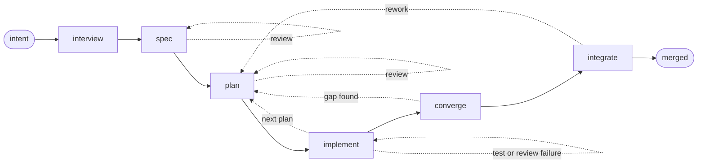

<p align="center">
  
</p>

# imp

**Stop babysitting your coding agent.**

<p>
  
  
  
</p>

imp is an AI agent workflow engine for developing software.  It takes a change
from idea through interview, spec, planning, implementation, review, testing,
integration, and merge.

It runs coding agents and LLM providers through a deterministic workflow,
avoiding long human-managed Claude Code sessions by splitting the development
process into a configurable series of short-lived, focused LLM sessions.

## Why use imp?

- **Unattended end to end** — Human effort concentrates up front, in a single
  interview; once you approve, imp runs spec, plan, code, test, review, and
  merge on its own, so you're free to step away from the computer
- **Lifecycle management** — Every change lives in a *quest*: a durable unit
  of work with a unique id, tracked from the opening idea through to the merge,
  archived on disk as a self-contained record
- **One interruption, not twenty** — When a question or spec deviation comes
  up mid-run, imp makes a judgment call and continues, deferring the final
  decision to the end, where you approve the change, send it back for rework,
  or file a follow-up as a backlog quest
- **Full provenance for every line of code** — Every conversation in a quest
  is archived, so you can trace any code to the discussion that produced it
- **Fresh context and independent reviewers** — Each step gets its own agent
  with a clean slate, with specs, plans, and progress files carrying decisions
  forward, avoiding long sessions where agents get increasingly confused
- **Bugs rooted out early** — The later a flaw is caught, the more it costs to
  fix, and an agent will faithfully implement a flawed spec, so imp loops
  on adversarial review over the spec and plan 
- **Built-in regression protection** — imp leans heavily on TDD and writes a
  lot of regression tests; keeping them green is the agents' job, not yours
- **Run multiple quests in parallel** — A quest runs in its own git worktree,
  so several can run in parallel, and can be paused or resumed at any time

## Example

Here's an example of imp running on itself with its [default workflow](#default-workflow).

*[Edited for brevity.  Full transcript [here](docs/examples/samo71.md).]*

```console
$ imp new "add a --json flag to imp list"
samo71 · new

  [imp splash screen]

> add a --json flag to imp list

  [3 explorer subagents map the code in parallel]

• Named this quest `JSON output for imp list`.  Here's what I found and what
  I propose.

  Today imp list gathers rows in src/imp/cli/main.py:3383 and :3420, each of
  which loads data and immediately renders it through quest_row.  The data is
  already clean, so adding --json is mostly splitting gathering from rendering.

  The one real design question is the shape.  imp already has three --json paths
  to be consistent with: imp show --json emits machine-valued status
  (merge_blocked, not "merge blocked") [...]

  [proposes three designs, gives much more detail]

  My recommendation: a flat, zone-tagged array, in the board's display order.

> ok

• Settled, then. To read it back in one piece before I set it up:

  [concise yet detailed design summary]

  Ready for me to set this up and start building? Declining sets it aside, and
  you can pick it back up later with imp resume samo71.

> ok

• I'll fork the worktree and write the spec.

  [spec]                       ✓
  [spec review]                ✓
  [plan 1]                     ✓
  [plan 1 review]              ✓
  [plan 1 implementation]      ✓
  [plan 1 code review]         ✓
  [plans 2-3]                  ✓
  [full test suite]            ✓
  [final code review]          ✓
  [integration]                ✓

Merged samo71 into master.
```
Mid-run screenshot:

<p align="center">
  
</p>

<p align="center">
  <em>Mid-flight: plan 1 of 3, task 1 of 3, with a <code>coder</code> subagent working under a context budget.</em>
</p>

Stats:
- 2h 6m runtime
- 10 commits
- 26 new tests
- ~0.7% of a Claude Max 20x monthly quota

Full quest log and quota summary: [`docs/examples/samo71.md`](docs/examples/samo71.md)

This quest used imp's [default workflow](#default-workflow), which is more
heavyweight than a typical Claude session, taking 2+ hours for a minor feature.
Most of the time and tokens were spent during design and planning, before any
code was written.  That up-front effort makes the code more functional,
maintainable, tested, and more likely to meet the user's expectations, with
fewer "surprises".

For that reason, when using the default workflow, **a Claude Max 20x (or
ChatGPT Pro) subscription is recommended.**  Without a subscription, the above
feature would have cost ~$40 in Anthropic API tokens.  Local models are not
(yet) supported.  Pull requests welcome :-)

If you want to use less resources for a given project or quest, feel free to
create your own workflow YAML file.  I've iterated on the default workflow over
several months for building imp on imp, and I think it's worth the tokens if
you want to have a maintainable project with decent code.

Note that multiple quests can be run in parallel for a given project.  I often
have a pipeline of 3-5 quests going.

## Try it

imp needs Git, Python 3.11+, and `uv`.

For automatic sandboxing (currently Linux-only), it also needs
[bubblewrap](https://github.com/containers/bubblewrap), and util-linux 2.38+
(`nsenter`, `unshare`).

Login to your `claude` CLI (or `codex`) and ensure they're in your path.  Or to
use provider APIs, export `ANTHROPIC_API_KEY` or `OPENAI_API_KEY`.  Imp has a
pluggable provider backend but local models are not yet supported.

### New project (greenfield)

```bash
uv tool install git+https://github.com/jpoimboe/imp

mkdir /path/to/my-new-app
cd /path/to/my-new-app
imp init
imp new "build a local-first task tracker with a web UI"
```

After initializing the repository with `imp init`, `imp new` starts the
interview.  It asks questions, proposes options, pushes on tradeoffs, and
spikes throwaway code when the answer needs an experiment rather than an
opinion.

When the design is settled, it creates a git worktree and runs off on its own.
You can pause it at any time with Ctrl-D for resuming later with `imp resume`,
or interrupt the agent at any time with Ctrl-C to ask a question or send it in
a different direction.

After the first quest, once the master branch has code, multiple quests can be
run on the project in parallel, in different terminal tabs.

Instead of `imp new`, you can use `imp chat` to ask imp questions about itself,
the code base, bugs or new features.

### Existing projects (brownfield)

Brownfield projects are also supported.  Just run `imp init` and `imp new` from
an existing git checkout.

```bash
cd /path/to/my-existing-app
imp init
imp new "add rate limiting to the public API"
```

## Quests

A *quest* represents a unit of work, from the opening intent to the final
merge: kind of like a pull request that starts at the idea instead of the
finished diff.

After the initial interview, the quest "goes live", with its own worktree,
artifacts, and event log.  Prompts, responses, and tool outputs are logged
alongside decisions, test runs, and gate outcomes.  State is rebuilt from the
log rather than held only in memory, so an interrupted run can be resumed in
the middle of a step.

When the quest finishes, its conversation and artifacts are archived and remain
searchable.  Quests can be interacted with via the CLI:

```bash
imp list                         # active work, drafts, and backlog
imp show <id>                    # intent, status, timing, and result
imp log <id>                     # readable story of the run
imp log --summary <id>           # per-step ledger of time, tokens, and quota
imp search "rate limit"          # live and archived conversations
```

Every commit log produced by the default workflow carries a `Quest: <id>`
trailer.  That makes it possible to associate every line of code with the
quest and conversation that created it:

```bash
git blame path/to/file
git log -1 --format='%(trailers:key=Quest,valueonly)' <commit>
imp log <quest-id>
```

You can also see all in-progress, backlog, and completed/archived quests:

```console
$ imp list
ID      NAME                                                   STATUS    UPDATED
fego87  README that shows imp working                          running   0s

backlog:
jara67  Revisit migrating codex to the official app-server S…  backlog   10d
timo83  Make test_cmd_slow false skip the slow gate            backlog   36d
jiro48  Restore archived-row titles and intents under the sa…  backlog   36d
  … 15 rows elided …

completed:
samo71  JSON output for imp list                               merged    2h
gepa93  Wire the completion nudge into codex live tests        merged    10h
sobi11  Adopt filelock 4.0                                     merged    10h
vuka12  Cut redundant review ceremony                          merged    10h
  … 867 rows elided …
```

And full fast search is supported:

```console
$ imp search "merge queue"
433 matches for "merge queue"

vuka12 · Cut redundant review ceremony · archive · 10h
  … "wait-for-head": "waiting in merge queue", "reconciler": "resol …
  … body). _IR_SIG = "HEAD of the merge queue" def _prompt_carries_ir(**kw …

fesa14 · Wait for dependencies outside the provider call · archive · 6d
  … ** for the next quest in the **merge queue**, i.e. the next quest waiting …
  … acquire step, not yet head in merge queue → `raise AwaitingUserInput()` …
  … thing that happens when in the merge queue (and what happens today for cr …
  … +3 more

gevu23 · Resume without replaying the integrate phase · archive · 10d
  … aml # ── integrate: the FIFO merge queue (base lock from wait-for-head) …
  … lane label: waiting in merge queue rules: - {el …
  … y:1290–1293`), enqueues in the merge queue, waits until head, then **mark …
  … +8 more
```

## Default workflow

imp runs workflows, each of which consists of a YAML file and agent markdown
files.  The default "batteries included" workflow can be found [here](src/imp/assets/workflows/default/workflow.yaml).



## Engine features

The imp engine is workflow-agnostic.  It has features that keep quests
isolated, resumable, and inspectable:

- **Isolate each quest.** Once live, every quest gets its own git worktree and
  sandboxed agent tools, so several can run at once without breaking your
  system or touching your checkout, index, or stash.
- **Pause, resume, or redirect.** Pause a quest at any time with Ctrl-D, or
  interrupt a running agent with Ctrl-C to ask a question or send it in a
  different direction.  The append-only event log lets the run resume without
  throwing away the in-flight step or pretending it never happened.
- **Get notified and steer from Telegram.** imp can alert your phone when a quest
  needs input, pauses, fails, or finishes.  You can also directly interact with
  quests and create new ones from Telegram.
  See [remote-control setup](docs/guide/remote-control.md).
- **Keep the whole history searchable.** Conversations, artifacts, and tool
  events remain searchable after a quest finishes, and every line of code can
  be traced back to the conversation that produced it.
- **Inspect everything from the CLI.** See active, draft, backlog, and archived
  quests, then drill into any quest's current state, decisions, summary, readable
  log, or event stream.
- **Intra- and Inter-quest interaction.** Agents can inspect earlier steps and
  search or read other live and archived sibling quests.  With your approval,
  they can set dependencies or open new quests for work they discover.
- **Non-committal chat.** Use `imp chat` to ask questions about imp or your
  codebase, explore an idea, or scout existing work.  It remains just a
  conversation -- with no branch or worktree -- unless you decide to build,
  when it continues into the normal workflow.
- **Keep a real backlog.** Park ideas for later, or let agents file followup
  work they discover while building something else.
- **LLM provider agnostic.** imp supplies its own system prompt and agent
  tools, designed to work the same for all LLM providers.
- **Per-role LLM vendors/models.** A project or quest can use different model
  tiers or vendors for planning, coding, and review.
- **Carry project memory forward.** Standing, human-approved instructions in
  `imp/memory/` carry architectural decisions, local conventions, and
  cross-quest preferences into future quests.  See
  [project memory](docs/guide/memory.md).
- **Custom workflows.** Workflows, gates, model tiers, scripts, and agent
  prompts are ordinary files in your repo.  Customize the default workflow or
  replace it entirely.
- **Embed it in your own application.** A supported Python API can create quests,
  stream events, and answer the questions a workflow asks.  See the
  [embedding guide](docs/guide/embedding.md).
- **Cost monitoring.** See per-quest accounting of subscription quota and API
  token usage for both live and archived quests.
- **Not just for code.** The engine can drive other structured processes, not
  just software development.

## Isolation and security boundaries

Each live quest uses a separate git worktree.  Nothing touches your checkout,
index, or stash, and several quests can run at once.

A worktree is not a security boundary because worktrees share one `.git`.  imp
therefore runs agent shell commands under bubblewrap, in separate user, IPC, and
UTS namespaces.  The filesystem is read-only outside an explicit writable set;
credentials are replaced with empty mounts; and shared Git escape paths such as
hooks, config, the index, and refs outside the quest's namespace are remounted
read-only.

Network access is allowed by default; set `sandbox.network: false` to disable it.
File-editing tools enforce the same path policy in-process, so the kernel-level
guarantee applies to shell commands.

## Status and contributing

imp is pre-release.

See [Architecture](docs/internals/architecture.md) for an overview of the engine
and bundled workflows.

Issues and pull requests are welcome.  To work on imp itself, clone the repo and
run `make sync-env` for a `.venv` matching `uv.lock`, then `make check` before
opening a pull request.
