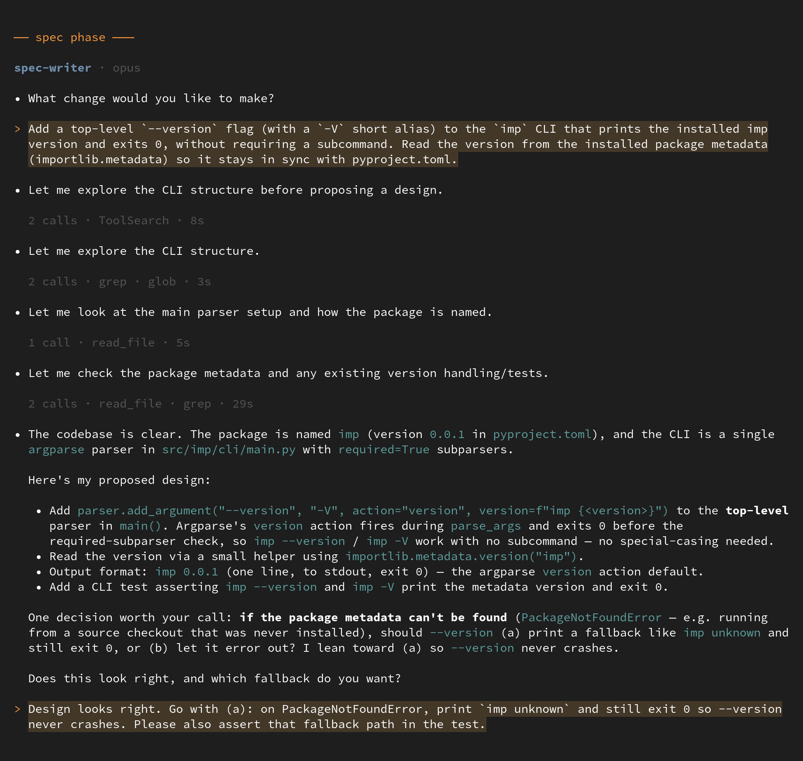

# imp

Tell imp what you want changed.  It interviews you until the design is settled, then specs it, plans it, reviews the plan, writes it test-first, reviews the diff, runs the tests, and merges.

  

<picture>
  <source media="(prefers-color-scheme: dark)" srcset="docs/images/imp-interview-dark.png">
  <source media="(prefers-color-scheme: light)" srcset="docs/images/imp-interview-light.png">
  
</picture>

Coding agents give you two settings today: approve every step, or hand over the keys.  imp is a third.  Your judgment goes in at the front, in a design conversation, and the structure carries it from there.  imp needs you at the front, not over its shoulder.

It has built itself since June 2026.  79% of the lines in `src/` arrived on a branch imp specified, reviewed, tested and merged on its own.

## Quickstart

```bash
git clone https://github.com/jpoimboe/imp && cd imp
python3 -m pip install -e .                      # needs Python 3.11+
imp init                                         # detects your base branch, workflow and test commands
imp new "add rate limiting to the public API"    # state intent; imp takes it from there
```

`imp new` opens the design conversation.  Work through it (it'll push back, propose options, and ask about the details it can't decide for you), then tell it to build.  From there it runs to the merge gate on its own, and surfaces again only if something genuinely needs your call.

## Why imp

- It interviews you first.  imp reads your code before it asks you anything, proposes two or three approaches with tradeoffs, writes out the exact strings and values you'll end up seeing, and spikes throwaway code when a question can only be settled by running it.
- The review happens before the code exists.  Plans contain the verbatim code they intend to produce, so a bug is sitting in the plan already, where it costs a paragraph to fix instead of a diff.
- Reviewers are strangers.  Every artifact is reviewed by a different agent with a clean context, which never sees the reasoning that produced it and is told to verify every claim by opening the source.
- Tests come first, and they have to be able to fail.  imp's own codebase is 10,189 tests across 850 files, 194,000 lines of test code against 60,000 lines of source, nearly all of it written by imp under this rule.
- The workflow is a file you own.  The phases, the gates, the reviewers, the model tiers: one YAML file plus agent prompts, in your repo, under git.  The engine has no opinion of its own.
- Nothing touches your checkout.  Every change runs in its own git worktree, and every agent shell command runs under [bubblewrap](https://github.com/containers/bubblewrap) with credentials masked.

## What a change looks like

Quoted from `imp log` on a real change, with `…` where I cut for length.  Partway through, the test suite goes red:

```
↩ verify → task-lead  (Gate `./scripts/run-verify.sh fast` failed (exit 2))

• The failing test spawns a real sandbox and asserts that imp --help resolves the
  worktree's CLI via a PYTHONPATH shadow. My diff only changes bytes the archive
  progress helper writes to a TTY stderr; this test never touches the archive and
  captures a non-TTY subprocess, where the helper was and remains silent. Not
  attributable to my change either way, so I'm recording it as a tolerated
  failure rather than inventing a fix.
```

So it didn't invent a fix, edit the test, or loop until something turned green.  It also didn't quietly swallow the failure.  The toleration goes in the record, so it has to surface at the merge gate, and at the gate it went and found the backlog quest already tracking that test before closing the item and merging.

That change took twenty-six minutes, twenty-one steps, and two keystrokes from me.  It cost $6.10.  Across imp's forty most recent merged changes the median was $46, the middle half fell between $27 and $96, and the largest was $339.  Those are API list prices from the provider SDK, and they buy a merged change: specified, reviewed, planned, reviewed again, implemented, code-reviewed, tested, rebased, tested again, and reviewed once more at the integration point.

<details>
<summary><code>imp log --summary</code> for that run</summary>

```
default  ·  fori10  ·  merged  ·  26m 25s  ·  4.2M  ·  $6.10
threshold
  threshold                           7m 50s  790.3k  $2.21
  scope-code-check                        0s       —      —
plan
  plan-writer                          2m 8s  726.1k  $0.76
  plan-verify-commit                      0s       —      —
  plan-finalized                          0s       —      —
implement
  task-lead                           4m 32s  435.8k  $0.51
    ↳ coder (writing code)            1m 10s  173.2k  $0.14
    ↳ code-reviewer (reviewing code)  1m 40s  177.5k  $0.19
  verify                              2m 13s       —      —
  task-lead                              57s  186.5k  $0.36
  check-next-plan                         0s       —      —
converge
  gap-check                           1m 11s  260.2k  $0.32
  quest-review                         3m 0s  945.3k  $0.87
  deferred-sweep                         19s   57.6k  $0.14
  converge-verify                     1m 28s       —      —
  deferred-sweep                         40s  101.5k  $0.17
integrate
  wait-for-head                           0s       —      —
  integrate-rebase                        0s       —      —
  summarizer                             22s   62.6k  $0.06
  finalize                            1m 20s  286.8k  $0.36
  cleanup-merge                           0s       —      —
  assert-stamped                          0s       —      —
  merge-to-base                           0s       —      —
```

The script steps that just route on an exit code cost nothing, and they show up that way.  Run `imp log --summary <id>` on a change of your own for the same breakdown.

</details>

## How it works

imp is a deterministic engine driving a declarative workflow.  The engine decides nothing about your code.  It sequences steps, routes on their results, and records what happened.  Each step is a separate model invocation with its own context, its own tools and its own tier, so there's no long session to drift.


`plan` and `implement` repeat per plan.  `converge` checks the finished work against the spec's acceptance criteria and sends it back if anything is missing.  `integrate` takes a merge-queue slot, rebases onto the current base, re-runs the slow tests, and merges locally.  No force pushes, no PR left open.

Underneath all of it is an append-only event log, and that log is the single source of truth.  Every step, tool call and decision gets recorded, and state is a cursor rebuilt from the log, so a run interrupted in the middle of a model call resumes without losing the thread.  That same log renders the live view, `imp log`, and the summary above, which is why every claim on this page is one you can print for yourself.

## Isolation and sandboxing

The worktree isolates the change: nothing touches your checkout, your index or your stash, and several changes can be in flight at once.  But a worktree isn't a security boundary, since worktrees share one `.git`.  So imp also runs every agent shell command under bubblewrap in its own user, IPC and UTS namespaces, with the filesystem read-only apart from an explicit writable set, credentials replaced by empty mounts rather than merely left unread, and the escape paths in the shared `.git` (`hooks`, `config`, `index`, and every ref outside the agent's own namespace) re-mounted read-only.  This fails closed: no `bwrap`, no run.

Two limits worth stating plainly.  Network access is *not* namespaced by default, so set `sandbox.network: false` to cut it off.  And imp's file-editing tools enforce the same path policy in-process rather than through the kernel, so the kernel-level guarantee covers shell commands.

## Going deeper

- [`docs/guide/what-is-imp.md`](docs/guide/what-is-imp.md): the model behind imp, and what a quest, phase and draft are
- [`docs/guide/features.md`](docs/guide/features.md): review gates, project memory, per-step model tiers, running on your subscription
- [`docs/guide/introspection.md`](docs/guide/introspection.md): reading logs, events and history
- [`docs/guide/lifecycle.md`](docs/guide/lifecycle.md): statuses, zones, drafts, and what happens when you leave one
- [`docs/guide/remote-control.md`](docs/guide/remote-control.md): drive a run from Telegram
- [`docs/guide/embedding.md`](docs/guide/embedding.md): the `imp.api` surface for embedding imp
- [`docs/internals/architecture.md`](docs/internals/architecture.md): the engine, and the default and minimal workflows

## Status

imp is pre-release.  The engine and the default workflow are in daily use, but interfaces may still shift before a tagged release.

It runs on the coding-agent subscription you already pay for, driving the official `claude` and `codex` binaries through the vendors' published agent SDKs (or the Anthropic and OpenAI APIs directly, with a key).  To be precise about what that is: imp is an independent harness that spawns those binaries.  It isn't an Anthropic or OpenAI product and carries no endorsement from either.

Issues and pull requests are welcome.  Start from a clone with `make sync-env` (builds a `.venv` from `uv.lock`) and run `make check` (lint, types, lockfile, tests) before opening a PR.

## License

Apache 2.0.  See [LICENSE](LICENSE).  Third-party attribution is in [NOTICE](NOTICE).
