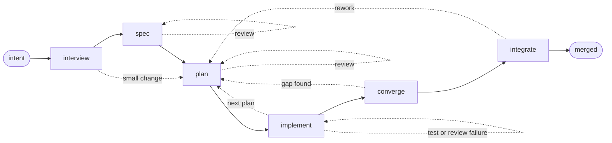

<p align="center">
  
</p>

# imp

**Stop babysitting your coding agent.**

  

**imp is a declarative agent workflow engine for software development.**  Each
change (feature or bug) for a given project gets built as part of an isolated,
resumable **quest**, which tracks the change's history from inception through
design, planning, coding, review, testing, and integration.

**Human effort is concentrated up front**, at the beginning of the quest, during
the interview with the "threshold" agent.  Once it has picked your brain
sufficiently, the workflow typically runs unattended all the way through merge,
so you're free to step away.  Or, kick off another quest in parallel!

imp front-loads deliberation, so expect hours of machine time, millions of
tokens, and real subscription spend for anything non-trivial.  Most of it goes
to thinking rather than typing: writing the spec, reviewing it, planning each
chunk of work, reviewing those plans.  A spec is rewritten until a fresh
reviewer clears it -- often several rounds -- and so is every plan.

That is the design, not overhead.  A reviewer who never saw the author's
reasoning catches mistakes while they are still an unbuilt paragraph, and
planning a chunk of work often takes longer than building it.  Rewriting a plan
is cheap; rewriting a merged feature is not.

Since its early bootstrap phase, imp has written all of its own code, with
**no human code review**.  That has worked out much better than I expected,
both in code quality and maintainability.

Humans still need to be heavily involved in the up-front interview/design
phase, and in judging whether the result actually works.  The resulting code
quality and maintainability don't come cheap though, so for serious use I
recommend a Claude Max or ChatGPT Pro subscription.

## Try it

imp needs Linux, Git, Python 3.11 or newer, `uv`,
[bubblewrap](https://github.com/containers/bubblewrap), and util-linux 2.38 or
newer (`nsenter`, `unshare`).  For model access, either install and sign in to
the `claude` or `codex` CLI with an existing subscription, or export
`ANTHROPIC_API_KEY` or `OPENAI_API_KEY` for direct API access.  For web work,
add a browser: imp renders and drives real pages for mockups and browser tests,
and an agent that finds none will spend a few minutes downloading ~115 MB of
Chromium into `~/.cache`.

```bash
uv tool install git+https://github.com/jpoimboe/imp

mkdir /path/to/my-app
cd /path/to/my-app
imp init
imp new "build a local-first task tracker with a web UI"
```

After initializing the repository with `imp init`, `imp new` starts the
interview.  It asks questions, proposes options, pushes on tradeoffs, and
spikes throwaway code when the answer needs an experiment rather than an
opinion.

When the design is settled, it creates a git worktree and runs off on its own.
You can pause it at any time with Ctrl-D for resuming later with `imp resume`,
or interrupt the agent at any time with Ctrl-C to ask a question or send it in
a different direction.

Brownfield development works too.  Run `imp init` and `imp new` from an
existing checkout; imp reads the code before asking questions and fits the
feature to the existing code.

## Features

### Default workflow



The default workflow is deliberately opinionated -- it follows best practices
for producing high quality, TDD, fully AI-written code in a fast-moving
greenfield solo or small team project -- and built around these rules:

- **Put human judgment up front.** imp asks about decisions it cannot make from
  the code, while changing the design is still cheap.  Once the design is
  settled, it typically drives the rest of the quest through merge on its own.
- **Save questions for the end.** During the unattended run, agents resolve what
  they safely can and record genuine judgment calls instead of stopping to ask.
  The merge gate presents the remaining decisions together before anything
  lands.
- **Start every step fresh.** Each step is a separate model invocation with only
  the context it needs, to avoid entering the dreaded LLM "dumb zone".  Specs,
  plans, and progress files carry decisions forward; reviewers do not inherit
  the author's reasoning or assumptions.
- **Spec-driven development.** A spec defines the result and its acceptance
  criteria.  An implementation plan names the code and tests needed to get there.
  On the full path, both are reviewed before implementation starts.
- **Adversarial review.** The agents reviewing the spec, plan, and code
  did not write them.  They inspect the repository and verify claims instead of
  inheriting the previous agent's assumptions.
- **Test-driven development.** New tests must be observed failing for the
  expected reason before implementation.  A test that never proved it could fail
  is not evidence.
- **Converge on the spec.** After implementation, imp checks the whole change
  against the acceptance criteria, runs the slow tests, and routes gaps back into
  planning or implementation.
- **Verify the integrated result.** imp takes a merge-queue slot, rebases onto
  the current base, resolves conflicts, reruns verification, reviews the
  integrated result, and merges it.
- **Sweep up non-blocking review comments.** Correctness blockers loop back for
  an immediate, re-reviewed fix.  Everything else worth considering goes through
  a separate, once-per-quest quality sweep, which fixes low-risk improvements,
  filters out noise, and saves genuine judgment calls for the merge gate.
- **Triage failures instead of chasing green.** Failures caused by the change are
  fixed and retested.  Unrelated or environmental failures are recorded and
  surfaced at the merge gate instead of provoking an invented fix.
- **Keep the code lean and maintainable.** Coders and reviewers push back on
  speculative fallbacks, dead error handling, and compatibility shims that the
  design did not ask for.
- **Work through big changes one plan at a time.** imp implements and fast-tests
  each plan before starting the next, then reviews the whole quest as one change.
- **Take the short path for small changes.** The full path writes and reviews a
  spec and each implementation plan.  Small corrective quests can skip the spec
  and plan review while keeping implementation, convergence, and integration
  intact.

### Engine features

The workflow sits on top of engine features that keep quests isolated,
resumable, and inspectable:

- **Isolate each quest.** Once live, every quest gets its own git worktree and
  sandboxed agent tools, so several can run at once without breaking your
  system or touching your checkout, index, or stash.
- **Pause, resume, or redirect.** Pause a quest at any time with Ctrl-D, or
  interrupt a running agent with Ctrl-C to ask a question or send it in a
  different direction.  The append-only event log lets the run resume without
  throwing away the in-flight step or pretending it never happened.
- **Get notified and steer from Telegram.** imp can alert your phone when a quest
  needs input, pauses, fails, or finishes.  From the same chat, you can follow
  multiple quests, reply to them, and start or resume work.  See
  [remote-control setup](docs/guide/remote-control.md).
- **Keep the whole history searchable.** Conversations, artifacts, and tool
  events remain searchable after a quest finishes, and every line of code can
  be traced back to the conversation that produced it.
- **Inspect everything from the CLI.** See active, draft, backlog, and archived
  quests, then drill into any quest's current state, decisions, summary, readable
  log, or event stream.
- **Let agents work across quests.** Agents can inspect earlier steps and search
  or read other live and archived sibling quests.  With your approval, they can
  link related backlog items or open new ones for work they discover.
- **Non-committal chat.** Use `imp chat` to ask questions about imp or your
  codebase, explore an idea, or scout existing work.  It remains just a
  conversation -- with no branch or worktree -- unless you decide to build,
  when it continues into the normal workflow.
- **Keep a real backlog.** Park ideas for later, or let agents file follow-up work
  they discover while building something else.
- **Choose models per role.** A project or quest can use different model tiers
  or vendors for planning, coding, and review.
- **Keep agents consistent across backends.** imp supplies its own system prompt
  and agent tools, and disables Claude's and Codex's native equivalents.  Every
  backend gets the same instructions, tool interface, and permission checks.
- **Carry project memory forward.** Standing, human-approved instructions in
  `imp/memory/` carry architectural decisions, local conventions, and
  cross-quest preferences into future quests.  See
  [project memory](docs/guide/memory.md).
- **Change the process.** Workflows, gates, model tiers, scripts, and agent
  prompts are ordinary files in your repo.  Customize the default workflow or
  replace it entirely.
- **Embed it in your own application.** A supported Python API can create quests,
  stream events, and answer the questions a workflow asks.  See the
  [embedding guide](docs/guide/embedding.md).
- **Not just for code.** The engine can drive other structured processes, not
  just software development.

## A quest leaves a trail

A quest represents a unit of work, from the opening intent to the final merge.
Before going live, it's only a conversation: no branch or worktree.  You can
build it, park it in the backlog, or discard it.

Once live, the quest owns its worktree, artifacts, workflow snapshot, and
append-only event log.  Prompts, responses, and the tool events exposed to imp
go into that local log alongside decisions, test runs, and gate outcomes.
State is rebuilt from the log rather than held only in memory, so an
interrupted run can resume in the middle of a step.  The log can contain source
code and command output; treat the archive as source-sensitive data.

When the quest finishes, its conversation and artifacts are archived and remain
searchable.  The commit is not the only surviving explanation of the change:

```bash
imp list                         # active work, drafts, and backlog
imp show <id>                    # intent, status, timing, and result
imp log <id>                     # readable story of the run
imp events <id> --agent coder    # the coder's event stream
imp search "rate limit"          # live and archived conversations
imp events search "pytest"       # tool calls, results, and agent reasoning
```

Every non-merge commit produced by the default workflow carries a `Quest: <id>`
trailer.  That makes the provenance path concrete:

```bash
git blame path/to/file
git log -1 --format='%(trailers:key=Quest,valueonly)' <commit>
imp log <quest-id>
```

Start with a line, find its commit, read the quest ID, then inspect the archived
conversation that produced it.

## Isolation and security boundaries

Each live quest uses a separate git worktree.  Nothing touches your checkout,
index, or stash, and several quests can run at once.

A worktree is not a security boundary because worktrees share one `.git`.  imp
therefore runs agent shell commands under bubblewrap, in separate user, IPC, and
UTS namespaces.  The filesystem is read-only outside an explicit writable set;
credentials are replaced with empty mounts; and shared Git escape paths such as
hooks, config, the index, and refs outside the quest's namespace are remounted
read-only.  This fails closed: no `bwrap`, no run.

Network access is allowed by default; set `sandbox.network: false` to disable it.
File-editing tools enforce the same path policy in-process, so the kernel-level
guarantee applies to shell commands.

## Status and contributing

imp is pre-release.  The engine and default workflow are in daily use, but
interfaces may change before the first tagged release.

See [Architecture](docs/internals/architecture.md) for an overview of the engine
and bundled workflows.

Issues and pull requests are welcome.  To work on imp itself, clone the repo and
run `make sync-env` for a `.venv` matching `uv.lock`, then `make check` before
opening a pull request.
