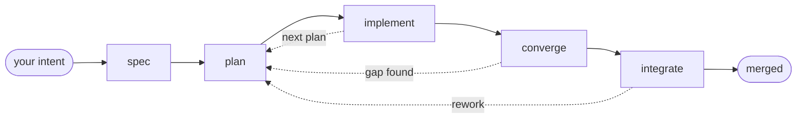

# imp

**A development process that runs itself.** You bring a change you want made; imp interviews you until the design is actually settled, then turns it into a specified, planned, reviewed, tested, merged change. It needs you at the front — not over its shoulder.

Today's coding agents offer two settings: approve every step, or hand over the keys. imp is a third. The conversation at the start is where your judgment goes; the structure carries it from there.

## What a change actually looks like

A real change to imp itself, quoted from `imp log` — verbatim, with `…` wherever I've cut for length. This one is small, so the conversation is short. It starts with one sentence:

```
$ imp new "when migrating and reindexing, and showing the status, don't erase each line when done"
```

imp reads the code before it asks you anything, then comes back with the one thing it can't decide for you:

```
• Found the progress helper. Let me check whether other commands do the same
  erase-on-done, and what showing the status refers to.

  9 calls · bash · read_file · rename_quest · 1m 29s

• I've named this Persist archive migration progress lines.

  Here's what's there now. One helper, _progress at
  src/imp/engine/archive/__init__.py:91, drives both counters — "Migrating
  archive..." at line 212 and "Reindexing archive..." at line 125. It repaints a
  dim line in place on stderr (only when stderr is a terminal), and on exit its
  finally writes \r\x1b[K, wiping the line. A stale archive runs the migration
  pass and then a reindex, so today a long upgrade flashes two counters and
  leaves the scrollback with no evidence it happened.

  …

  That leaves this in scrollback, both lines dim, before whatever the command
  was going to print:

  Migrating archive... 128/128
  Reindexing archive... 128/128

  The one real choice is the wording of the line that now sticks around:

   1 Keep the last frame verbatim — Migrating archive... 128/128, Reindexing
     archive... 128/128. No new copy, and the counter carries the record. The
     ellipsis reads slightly "in progress" for a finished line.
   2 Rewrite to a past-tense completion line — Migrated archive: 128 quests,
     Reindexed archive: 128 quests. Reads better as a permanent record, but adds
     a second label to each call site.

  I recommend 1: the counter is the information, and it keeps the helper a
  single-purpose progress printer. Which do you want?

…

> 1
```

For a change this size, that was the only open question. From there it writes a spec, plans the work, implements it, reviews its own diff, and runs the tests — unattended. Partway through, the suite goes red:

```
↩ verify → task-lead  (Gate `./scripts/run-verify.sh fast` failed (exit 2))

…

• The failing test spawns a real sandbox and asserts that imp --help resolves the
  worktree's CLI via a PYTHONPATH shadow — console-script/startup-import
  resolution. My diff only changes bytes the archive progress helper writes to a
  TTY stderr; this test never touches the archive and captures a non-TTY
  subprocess, where the helper was and remains silent. Notably, the commit
  directly beneath mine is the base merge "Cut imp CLI startup import cost,"
  which deferred main.py's imports — that is what this test exercises. Not
  attributable to my change either way, so I'm recording it as a tolerated
  failure rather than inventing a fix.
```

No speculative fix, no edited test, no death loop — and no quietly swallowed failure either. It records the toleration so the failure has to surface at the merge gate. When it gets there:

```
• Two open items, both tolerations of the same test. Let me check whether that
  test is already tracked elsewhere.

  2 calls · bash · 6s

…

• Confirmed — voli59 is a backlog quest that records this exact test failing
  reproducibly, and another quest (dajo65) already back-linked to it. Recording
  the linkage and closing both lines.

  2 calls · bash · edit_file · 25s

• Both open items resolved to the existing tracker, so nothing needs your call —
  this merges automatically.

  …

  Approving the merge now.

…

Merged fori10 into master.
```

Twenty-six minutes, twenty-one steps, and two keystrokes from me: `1`, then `ok`. `imp log --summary` prints the whole run with what each step cost — the script steps that route on an exit code cost nothing and are shown as such:

```
default  ·  fori10  ·  merged  ·  26m 25s  ·  4.2M  ·  $6.10
threshold
  threshold                           7m 50s  790.3k  $2.21
  scope-code-check                        0s       —      —
plan
  plan-writer                          2m 8s  726.1k  $0.76
  plan-verify-commit                      0s       —      —
  plan-finalized                          0s       —      —
implement
  task-lead                           4m 32s  435.8k  $0.51
    ↳ coder (writing code)            1m 10s  173.2k  $0.14
    ↳ code-reviewer (reviewing code)  1m 40s  177.5k  $0.19
  verify                              2m 13s       —      —
  task-lead                              57s  186.5k  $0.36
  check-next-plan                         0s       —      —
converge
  gap-check                           1m 11s  260.2k  $0.32
  quest-review                         3m 0s  945.3k  $0.87
  deferred-sweep                         19s   57.6k  $0.14
  converge-verify                     1m 28s       —      —
  deferred-sweep                         40s  101.5k  $0.17
integrate
  wait-for-head                           0s       —      —
  integrate-rebase                        0s       —      —
  summarizer                             22s   62.6k  $0.06
  finalize                            1m 20s  286.8k  $0.36
  cleanup-merge                           0s       —      —
  assert-stamped                          0s       —      —
  merge-to-base                           0s       —      —
```

## It interviews you first

The conversation above was short because the change was small. That is the exception.

imp's opening step is a working design interview, and it is deliberately unhurried. It reads your code before it asks you anything — dispatching parallel subagents to map the parts your change touches — so it never asks what it could have looked up. It proposes two or three approaches with tradeoffs and a recommendation. It writes out the exact strings, labels, and values you'll end up seeing, rather than deferring them to an implementation that would otherwise invent them. Where a question can only be settled by running code, it writes a throwaway spike and runs it. It keeps asking until nothing load-bearing is unresolved, then writes the spec and hands it to a reviewer that argues with it.

A one-line fix converges in a few minutes. A change of real substance does not. The run above cost $6.10 end to end; a recent sandbox bug — which arrived as a pasted stack of error messages rather than a tidy sentence — spent 1 hour and 10 minutes in that opening conversation, across seven code explorations and one throwaway spike, before a single line was written. That hour was $21 of a $117 change, and it is the part that decides whether the other $96 is spent on the right thing.

This is the trade imp makes. You are not freed from thinking about the change; you are freed from watching it get made.

## Why

**You are the bottleneck now.** Approve-every-step turns you into a permission dispenser until you stop reading the prompts; hand-over-the-keys asks you to trust an unsupervised loop with your repository. imp's answer is that supervision belongs at the front.

**Reviewing a diff is the expensive way to find a bug.** When an agent produces 1,200 lines in ten minutes, review becomes the whole job — and it is the part that did not get faster. imp front-loads it: the spec and the plan each get an adversarial review round before a line of code exists, and every reviewer judges work it did not write.

**Long sessions rot.** Every step is a fresh agent with a tightly scoped context, assembled from the workflow and the event log rather than inherited from a conversation that has been running for four hours. There is no long session to drift.

## How it works

imp is a **deterministic engine** driving a **declarative workflow**. The engine decides nothing about your code — it sequences steps, routes on their results, and records everything. Each step is a separate model invocation with its own context, its own tools, and its own tier.

Every change moves through the same lifecycle, in its own git worktree:



`plan` and `implement` repeat per plan. `converge` runs once at the end, checks the finished work against the spec's acceptance criteria, and sends it back for another plan if anything is missing. `integrate` takes a merge-queue slot, rebases onto the current base, re-runs the slow tests, and merges locally — no force pushes, no PR left open.

Underneath, an append-only **event log is the single source of truth**. Every step, tool call, and decision is recorded per change; state is a cursor rebuilt from the log, so a run interrupted mid-model-call resumes without losing the thread. The same log renders the live view, `imp log`, and the summary above — which is why every claim on this page is one you can print for yourself.

## The workflow is a file

Everything below — the phases, the gates, the reviewers, the TDD discipline, which model each step runs on — is one declarative YAML file plus a directory of agent prompts, sitting in your repo under `imp/` and tracked by git. The engine reads it and has no opinion of its own. Nothing in the engine — not the event log, not the gates, not the review loops, not the tiered model routing — knows what a step is *for*. It sequences, routes, and records; the file decides the rest.

So the default workflow is a *default*, not the product. It encodes current best-practice agentic engineering as we understand it today — adversarial spec and plan review, test-first implementation, whole-diff review, a merge queue, human gates where judgment actually helps — and it is what you get out of the box, tuned and in daily use. It is also legible, and yours. Add a security review before integration. Change a reviewer's tier. Delete a phase your project doesn't need. Or write one from scratch — the engine will run it.

| Workflow | Shape | For |
|---|---|---|
| `default` | `spec → (plan → implement)* → converge → integrate` | The full pass: 28 steps, 19 agents, merges when it's done |
| `minimal` | `interview → implement → review → finalize` | Small changes; no plan phase, leaves commits on a branch for you to merge |

`minimal` is the useful proof that this is real: it has no plan phase, no test gate, and no merge, and the engine runs it without knowing the difference.

Pick one at setup with `imp init`, per change with `imp new --workflow <name>`, or write your own. Each run works from a snapshot of the workflow taken when it starts, so editing the file never disturbs a run already in flight; a change paused at a gate picks up your edits when you resume it.

## The review happens before the code exists

The default workflow earns its keep here: a plan review at imp is a code review. Plans contain the verbatim code they intend to produce, so a bug — if there is one — is sitting in the plan already, and it costs a paragraph to fix instead of a diff.

The spec and the plan each face a dedicated reviewer, and the reviewer is a **different agent with a clean context**. It never sees the conversation that produced the artifact — not the reasoning, not the tool calls, not the arguments that felt convincing at the time. It gets the artifact, the codebase, and an instruction to disbelieve:

> Trust nothing the plan asserts. Verify every factual claim yourself — file paths, current signatures, what existing code returns or does — by opening the source. A confident-sounding claim is not evidence.

So it opens the files and checks. A spec that describes a function that doesn't exist, or a plan whose code misses a call site or an error path, comes back as a blocking finding and the writer does it again. Findings are graded, and anything Critical or Major forces a rework round; the loop runs until the reviewer has nothing blocking left, up to ten rounds before imp stops and asks you.

This is the trade at the center of imp's design. An agent that writes 1,200 lines in ten minutes has moved the work to you — the reading, the checking, the "is this even the right approach". Reviewing a specification is cheap. Reviewing a plan is cheap. Reviewing 1,200 lines of someone else's confident code is not, and it is the part that never got faster.

## Tests come first, and they have to be able to fail

Every non-trivial change is implemented test-first. The coder carries the rule in its standing instructions, and it is unambiguous —

> **No production code without a failing test first** — wrote the code before its test? Delete it and implement fresh from the test.

— and the plan is structured to match: each task is a sequence of *write the failing test, run it, watch it fail, write the minimal implementation, run it again, commit.* One task, one commit, tests included.

The failure mode this invites is the sham test — one written after the fact whose expected value simply echoes what the code returns, so it passes and proves nothing. imp names that pattern and every reviewer hunts it:

> Could each test be green if the feature were broken? A test whose expected value merely echoes the implementation verifies transcription, not behavior.

Such a test is a **blocking** finding, the same severity as a genuine defect.

imp's own codebase is the result: **10,189 tests across 850 files, 194,000 lines of test code against 60,000 lines of source.** Nearly all of it was written by imp, test-first, under this discipline.

Two honest caveats. This is enforced by instruction and review, not by a mechanical gate — nothing inspects the order in which the bytes were written, so a reviewer catching a non-falsifiable test is what actually holds the line. And changes small enough to take the fast path skip test scaffolding deliberately, rather than padding a one-line fix with a ceremonial test.

## What it costs

Front-loading review means more model calls, not fewer, and it is fair to ask what that runs to. imp records tokens and cost per step, so these are measurements rather than estimates.

The run above cost **$6.10** end to end. Across imp's forty most recent merged changes the median was **$46**, the middle half fell between **$27 and $96**, and the range ran from **$4.40** for a small fix to **$339** for the largest in the sample.

Two things to know about those figures. They are API list prices as reported by the provider SDK — imp's own development runs on a Claude subscription, where the marginal cost of everything above was zero. And they buy a *merged* change: specified, reviewed, planned, reviewed again, implemented, code-reviewed, tested, rebased, tested again, and reviewed once more at the integration point. Compare it against the path that ends in the same place, not against a single prompt.

Run `imp log --summary <id>` on any change of your own for the same breakdown.

## Isolation and sandboxing

These are two different things and imp does both, so it's worth separating them.

**The worktree isolates the change.** Every change gets its own branch and its own git worktree. Nothing touches your checkout, your index, or your stash while a run is in progress, and several changes can be in flight at once without seeing each other's files.

**The sandbox restricts the agent.** A worktree is not a security boundary — worktrees share one `.git` directory, so an unconfined agent could reach the repository's hooks and config from inside one. imp runs every agent shell command under [bubblewrap](https://github.com/containers/bubblewrap) in its own user, IPC, and UTS namespaces: the filesystem is mounted read-only by default, with an explicit writable set (the worktree, `$HOME`, `/tmp`, toolchain caches), and credentials are masked outright — `~/.ssh`, `~/.aws`, `~/.gnupg`, `~/.docker/config.json`, `~/.netrc`, `~/.git-credentials` and friends are replaced with empty mounts, not merely unread. Over the shared `.git`, the paths that would let an agent escape are re-mounted read-only: `hooks`, `config`, `index`, and all of `refs/heads` except the agent's own `imp/` namespace. An agent cannot install a hook, rewrite git config, or move your `master`.

This is **fail-closed**: if `bwrap` isn't installed, a run refuses to start rather than quietly proceeding unconfined.

Two limits worth stating plainly. Network access is *not* namespaced by default — set `sandbox.network: false` to cut it off. And imp's file-editing tools enforce the same path policy in-process rather than through the kernel, so the kernel-level guarantee covers shell commands; the file tools are governed by imp's own code.

## Models and subscriptions

imp runs on the coding-agent subscription you already pay for. It drives the official `claude` and `codex` binaries through the vendors' published agent SDKs, reusing the credentials those CLIs wrote at login — there's no separate API key to configure and no re-implemented protocol. You can also point it straight at the Anthropic or OpenAI APIs with a key.

To be precise about what that is and isn't: imp is an independent harness that spawns those official binaries. It isn't an Anthropic or OpenAI product and carries no endorsement from either.

Model choice is per step. Each step declares a tier, and each tier maps to a model per provider:

```yaml
providers: [claude_code, openai]     # preference order
tiers:
  low:    {claude_code: claude-haiku-4-5,  openai: gpt-5.4-mini}
  medium: {claude_code: claude-sonnet-4-6, openai: gpt-5.4}
  high:   {claude_code: claude-opus-5[1m], openai: gpt-5.5}
```

The first provider whose credentials check out wins. Because the tier table spans vendors, one run can put the coder on one vendor and the reviewer on another — a step can even ask for the *most different* available model from another step's. The shipped workflow doesn't do this: it gets reviewer independence from fresh context and tier, within one provider. Splitting across vendors is yours to configure.

Whichever backend answers, the tools are imp's own — the same `bash`, `read_file`, `edit_file`, `grep`, and subagent dispatch, running in imp's process under imp's sandbox. Behavior doesn't change when you change models.

## Install

imp is a Python package and needs Python 3.11+. It's pre-release, so install from a clone:

```bash
git clone https://github.com/jpoimboe/imp && cd imp
python3 -m pip install -e .
imp init      # detects your workflow, base branch, and test commands; confirms on one screen
```

`imp init --use-defaults` does the same without prompting.

## Start a change

```bash
imp new "add rate limiting to the public API"   # state intent; imp takes it from there
imp list                                        # what's in flight, parked, and done
imp log <id>                                    # the readable narrative of a run
imp log --summary <id>                          # per-step time, tokens, and cost
imp resume <id>                                 # pick up a paused change
```

`imp new` opens the design conversation. Work through it — it will push back, propose options, and ask about the details it can't decide for you — and when you're both satisfied, tell it to build. From there it runs to the merge gate on its own, surfacing again only if something genuinely needs your call.

## More

- [`docs/guide/what-is-imp.md`](docs/guide/what-is-imp.md) — the model: changes, phases, drafts
- [`docs/guide/features.md`](docs/guide/features.md) — the full capability catalog
- [`docs/guide/introspection.md`](docs/guide/introspection.md) — reading logs, events, and history
- [`docs/guide/memory.md`](docs/guide/memory.md) — standing instructions that apply to every run
- [`docs/guide/remote-control.md`](docs/guide/remote-control.md) — drive a run from Telegram
- [`docs/guide/embedding.md`](docs/guide/embedding.md) — the `imp.api` surface for embedding imp
- [`docs/internals/architecture.md`](docs/internals/architecture.md) — engine and workflow internals

## Status

imp is **pre-release** and has built itself since June 2026: 79% of the lines in `src/` arrived on a branch imp specified, reviewed, tested, and merged on its own. The engine and the default workflow are in daily use; interfaces may still shift before a tagged release.

Issues and pull requests are welcome. Start from a clone with `make sync-env` (builds a `.venv` from `uv.lock`) and run `make check` (lint, types, lockfile, tests) before opening a PR.

## License

Apache 2.0. See [LICENSE](LICENSE).
