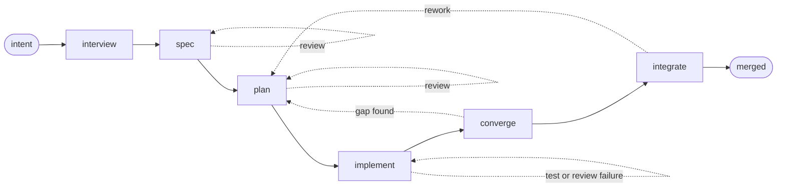

<p align="center">
  
</p>

# imp

**Stop babysitting your coding agent.**

  

imp is a declarative agent workflow engine for software development.  Each
change (feature or bug) for a given project gets built as part of an isolated,
resumable **quest**, which tracks the change's history from inception through
design, planning, coding, review, testing, and integration.

Each step is performed with fresh agent context, to avoid entering the dreaded
LLM "dumb zone", and to enable focused work and adversarial review.  Files are
used to communicate between steps.  Work can be split across different models
or providers as needed.

Human effort is concentrated up front, at the beginning of the quest, during
the interview with the "threshold" agent.  Once it has picked your brain
sufficiently, the workflow typically runs unattended all the way through merge,
so you're free to step away.  Or, kick off another quest in parallel!

Detailed specs, implementation plans, and progress files carry your decisions
between steps.  Tests are written first (TDD), every artifact is independently
reviewed, and the final code is checked against acceptance criteria before
merge.

Every conversation is archived, so you can easily trace any line of code back
to the full conversation which produced it.

Based on my experiences with imp, I am starting to believe that, for the
majority of projects, we are at the point where humans don't need to write *or*
review code.  But they do still need to be heavily involved in the up-front
interview/design phase, and testing.

Once I got past the early bootstrap phase of development, all of imp's
remaining code was written by imp itself, with no human code review.  Its use
of heavy up-front design and review, and its strong reliance on TDD and
integration testing has resulted in an impressive degree of quality and
maintainability, IMO.

Note my day job is an upstream Linux kernel developer/maintainer, which is a
very large distributed human-oriented project, for which imp is not (yet?) a
good fit.

Imp ships with an opinionated default workflow which follows best practices for
producing high quality, TDD, fully AI-written code in a fast-moving greenfield
solo or small team project, but it can be easily customized or replaced to
match your project's needs.  The engine is flexible enough that it can also be
used for non-coding projects or even business processes.

## Try it

imp needs Linux, Git, Python 3.11 or newer, and
[bubblewrap](https://github.com/containers/bubblewrap).  For model access, either
install and sign in to the `claude` or `codex` CLI with an existing subscription,
or export `ANTHROPIC_API_KEY` or `OPENAI_API_KEY` for direct API access.

```bash
git clone https://github.com/jpoimboe/imp
cd imp
python3 -m venv .venv
. .venv/bin/activate
python -m pip install -e .

mkdir ../taskboard
cd ../taskboard
imp init
imp new "build a local-first task tracker with a web UI"
```

`imp init` works in an empty directory: it initializes Git if needed, then
confirms the base branch, workflow, test commands, worktree setup, and provider.
`imp new` starts the interview.  imp turns the idea into concrete design options,
pushes on tradeoffs, and spikes throwaway code when the answer needs an
experiment rather than an opinion.

Brownfield works too.  Run `imp init` and `imp new` from an existing checkout;
imp reads the code before asking questions and fits the design to what is already
there.

When the design is settled, tell it to "build it" in the conversation; there is
no second shell command.  The quest leaves draft state, gets its own branch and
worktree, and runs on its own.  It surfaces again if something genuinely needs
your call.  You can watch it, leave it alone, interrupt it, or resume it later
from the event log.

<picture>
  <source media="(prefers-color-scheme: dark)" srcset="docs/images/imp-interview-dark.png">
  <source media="(prefers-color-scheme: light)" srcset="docs/images/imp-interview-light.png">
  
</picture>

## What the default workflow does



The shipped workflow is deliberately opinionated:

- **Interview before implementation.** Your judgment goes in while changing the
  design is still cheap.  imp asks about decisions it cannot make from the code,
  not facts it can discover itself.
- **Write the contract down.** A spec defines the result and its acceptance
  criteria.  An implementation plan names the code and tests needed to get there.
  Both are reviewed before implementation starts.
- **Use fresh context.** Every step is a separate model invocation with only the
  context it needs.  The spec and plan carry decisions forward; reviewers do not
  inherit the author's reasoning or assumptions, and there is no long-running
  session to drift.
- **Write tests first.** New tests must be observed failing for the expected
  reason before implementation.  A test that never proved it could fail is not
  evidence.
- **Keep the code lean.** Coders and reviewers push back on speculative
  fallbacks, dead error handling, and compatibility shims that the design did not
  ask for.
- **Make reviewers independent.** The agents reviewing the spec, plan, and code
  did not write them.  They are told to inspect the repository and verify claims,
  not agree with the previous agent.
- **Converge on the spec.** After implementation, imp checks the whole change
  against the acceptance criteria, runs the slow tests, and routes gaps back into
  planning or implementation.
- **Verify at the integration point.** imp takes a merge-queue slot, rebases onto
  the current base, resolves conflicts, reruns verification, reviews the
  integrated result, and merges it.  If something still needs your judgment, it
  surfaces at the merge gate instead.

This is the batteries-included workflow, not engine policy.  Its phases, routes,
gates, model tiers, scripts, and agent prompts are ordinary files in your
repository.  Keep it, change it, or replace it.  The engine only executes the graph
and records what happened.

Model choice is per role, so one quest can use different model tiers or vendors
for planning, coding, and review.  Standing project instructions are applied to
every run, so architectural decisions and local conventions do not have to be
restated for each quest.

## A quest leaves a trail

A quest is one unit of work from the opening intent to the final merge.  Before
you choose to build, it is only a conversation and some notes: no branch and no
worktree.  You can build it, park it in the backlog, or discard it.

Once live, the quest owns its worktree, artifacts, workflow snapshot, and
append-only event log.  Prompts, responses, and the tool events exposed to imp go
into that local log alongside decisions, test runs, and gate outcomes.  State is
rebuilt from the log rather than held only in memory, which is why an interrupted
run can resume without pretending the interrupted step never happened.  The log
can contain source code and command output; treat the archive as source-sensitive
data.

When the quest finishes, its conversation and artifacts are archived and remain
searchable.  The commit is not the only surviving explanation of the change:

```bash
imp list                         # active work, drafts, and backlog
imp show <id>                    # intent, status, timing, and result
imp log <id>                     # readable story of the run
imp events <id> --agent coder    # the coder's event stream
imp search "rate limit"          # live and archived conversations
imp events search "pytest"       # tool calls, results, and agent reasoning
```

Every non-merge commit produced by the default workflow carries a `Quest: <id>`
trailer.  That makes the provenance path concrete:

```bash
git blame path/to/file
git log -1 --format='%(trailers:key=Quest,valueonly)' <commit>
imp log <quest-id>
```

Start with a line, find its commit, read the quest ID, then inspect the archived
conversation that produced it.

## What happens when a test fails

A green test run is not an interesting test of the process.  Here is a real
excerpt from `imp log` where a verification gate went red partway through a
change:

```text
↩ verify → task-lead  (Gate `./scripts/run-verify.sh fast` failed (exit 2))

• The failing test spawns a real sandbox and asserts that imp --help resolves the
  worktree's CLI via a PYTHONPATH shadow. My diff only changes bytes the archive
  progress helper writes to a TTY stderr; this test never touches the archive and
  captures a non-TTY subprocess, where the helper was and remains silent. Not
  attributable to my change either way, so I'm recording it as a tolerated
  failure rather than inventing a fix.
```

It did not edit the unrelated test, invent a fix, or keep retrying until
something happened to turn green.  It recorded the toleration, which forced the
failure to surface again at the merge gate.  There it found the existing backlog
quest tracking that failure before closing the change and merging it.

That run took 26 minutes and 21 steps.  It cost $6.10 at provider API list prices.
Across the 40 merged changes in the same sample, the median was $46, the middle
half ranged from $27 to $96, and the largest was $339.  These are measurements of
imp developing this repository, not a cost forecast for another project.  They
cover the whole process: interview, specification, planning, independent
reviews, implementation, tests, rebase, integration review, and merge.

<details>
<summary><code>imp log --summary</code> for that run</summary>

```text
default  ·  fori10  ·  merged  ·  26m 25s  ·  4.2M  ·  $6.10
threshold
  threshold                           7m 50s  790.3k  $2.21
  scope-code-check                        0s       —      —
plan
  plan-writer                          2m 8s  726.1k  $0.76
  plan-verify-commit                      0s       —      —
  plan-finalized                          0s       —      —
implement
  task-lead                           4m 32s  435.8k  $0.51
    ↳ coder (writing code)            1m 10s  173.2k  $0.14
    ↳ code-reviewer (reviewing code)  1m 40s  177.5k  $0.19
  verify                              2m 13s       —      —
  task-lead                              57s  186.5k  $0.36
  check-next-plan                         0s       —      —
converge
  gap-check                           1m 11s  260.2k  $0.32
  quest-review                         3m 0s  945.3k  $0.87
  deferred-sweep                         19s   57.6k  $0.14
  converge-verify                     1m 28s       —      —
  deferred-sweep                         40s  101.5k  $0.17
integrate
  wait-for-head                           0s       —      —
  integrate-rebase                        0s       —      —
  summarizer                             22s   62.6k  $0.06
  finalize                            1m 20s  286.8k  $0.36
  cleanup-merge                           0s       —      —
  assert-stamped                          0s       —      —
  merge-to-base                           0s       —      —
```

Script steps that only route on an exit code cost nothing, and appear that way.
Run `imp log --summary <id>` to get the same accounting for your own quest.

</details>

## Isolation and security boundaries

Each live quest uses a separate git worktree.  Nothing touches your checkout,
index, or stash, and several quests can run at once.

A worktree is not a security boundary because worktrees share one `.git`.  imp
therefore runs agent shell commands under bubblewrap, in separate user, IPC, and
UTS namespaces.  The filesystem is read-only outside an explicit writable set;
credentials are replaced with empty mounts; and shared Git escape paths such as
hooks, config, the index, and refs outside the quest's namespace are remounted
read-only.  This fails closed: no `bwrap`, no run.

Two limits are worth stating plainly.  Network access is allowed by default; set
`sandbox.network: false` to disable it.  File-editing tools enforce the same path
policy in-process, so the kernel-level guarantee applies to shell commands.

## Documentation

- [What is imp?](docs/guide/what-is-imp.md) explains quests, phases, and drafts.
- [Features](docs/guide/features.md) covers review gates, project memory,
  per-role model selection, and remote control.
- [Lifecycle](docs/guide/lifecycle.md) covers statuses, the backlog, the archive,
  and what happens when you leave a conversation.
- [Introspection](docs/guide/introspection.md) covers logs, events, history, and
  search.
- [Embedding](docs/guide/embedding.md) documents the supported Python API.
- [Architecture](docs/internals/architecture.md) describes the engine and the
  bundled workflows.

## Status and contributing

imp is pre-release.  The engine and default workflow are in daily use, but
interfaces may change before the first tagged release.

imp drives the official `claude` and `codex` binaries through their published
agent SDKs, or uses the Anthropic and OpenAI APIs directly.  It is an independent
harness, not an Anthropic or OpenAI product, and carries no endorsement from
either.  Most production use so far has been with Claude Code.

Issues and pull requests are welcome.  From a clone, run `make sync-env` to build
the development environment from `uv.lock`, then run `make check` before opening
a pull request.

## License

Apache 2.0.  See [LICENSE](LICENSE).  Third-party attribution is in
[NOTICE](NOTICE).
