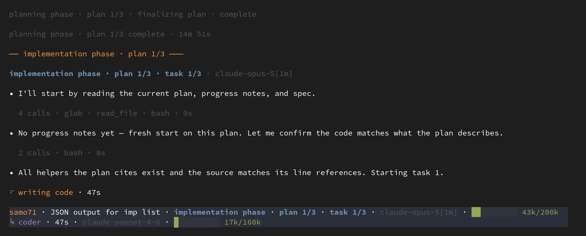

<p align="center">
  
</p>

# imp

**Stop babysitting your coding agent.**

imp is an agent workflow engine for developing software.  It takes a change
from idea through interview, spec, planning, implementation, review, testing,
and merge, allowing you to step away from the terminal.

It interviews you up front to nail down the details, then does the rest of the
work on its own in an isolated git worktree, using fresh agents for each stage.

<p>
  
  
  
</p>

## Example

Here's an abridged example of running imp on itself, adding a --json flag
to `imp list`.

*[Edited for brevity.  Full transcript [here](docs/examples/samo71.md).]*

```console
$ imp new "add a --json flag to imp list"
samo71 · new

  [imp splash screen]

> add a --json flag to imp list

  [3 explorer subagents map the code in parallel]

• Named this quest `JSON output for imp list`.  Here's what I found and what
  I propose.

  Today imp list gathers rows in src/imp/cli/main.py:3383 and :3420, each of
  which loads data and immediately renders it through quest_row.  The data is
  already clean, so adding --json is mostly splitting gathering from rendering.

  The one real design question is the shape.  imp already has three --json paths
  to be consistent with: imp show --json emits machine-valued status
  (merge_blocked, not "merge blocked") [...]

  [proposes three designs, gives much more detail]

  My recommendation: a flat, zone-tagged array, in the board's display order.

> ok

• Settled, then. To read it back in one piece before I set it up:

  [concise yet detailed design summary]

  Ready for me to set this up and start building? Declining sets it aside, and
  you can pick it back up later with imp resume samo71.

> ok

• I'll fork the worktree and write the spec.

  [spec]                       ✓
  [spec review]                ✓
  [plan 1]                     ✓
  [plan 1 review]              ✓
  [plan 1 implementation]      ✓
  [plan 1 code review]         ✓
  [plans 2-3]                  ✓
  [full test suite]            ✓
  [final code review]          ✓
  [integration]                ✓

Merged samo71 into master.
```
Mid-run screenshot:

<p align="center">
  
</p>

<p align="center">
  <em>Mid-flight: plan 1 of 3, task 1 of 3, with a <code>coder</code> subagent working under a context budget.</em>
</p>

Stats:
- 2h 6m runtime
- 10 commits
- 26 new tests
- ~0.5% of a Claude Max monthly quota

Full run log and cost summary: [`docs/examples/samo71.md`](docs/examples/samo71.md)

## Why imp?

Each change (feature or bug) for a given project gets built as part of an
isolated, resumable **quest**, which tracks the change's history from inception
through merge.  Every conversation is archived, so you can easily **trace any
line of code back to the full conversation which produced it.**

**imp is workflow-agnostic, but ships batteries included** with an 
opinionated default workflow for producing well-tested, reviewed, maintainable
code in a fast-moving greenfield or small team project.  The default workflow
is defined in YAML and can be easily customized or replaced to suit your needs.

**Human effort is concentrated up front** at the beginning of the quest, during
an interview with the "threshold" agent.  Once it has picked your brain
sufficiently, with your approval it runs unattended from spec, plan, code,
test, review, all the way through merge, so you're free to step away from the
computer.  The quest can be paused or resumed at any time.  You can also kick
off multiple quests in parallel, as imp runs in **resumable, isolated git
worktrees.**

For any surprises or open items discovered during the quest, imp agents make
judgment calls which are then raised back to the user at the merge gate for
their final approval.  They can then send it back for rework, or open a
follow-up backlog quest for further improvements.

imp uses **fresh LLM context and independent reviewers** so each agent can
focus on its given task, avoiding long sessions where agents get increasingly
confused.  Detailed specs, implementation plans, and progress files carry
decisions between steps.  Tests are written before code (TDD), every artifact
is independently reviewed in multiple rounds if needed, and the final code is
checked against acceptance criteria before merge.

**Bugs are rooted out early.**  With AI development, most bugs tend to
originate early during the spec or planning phase, due to gaps,
inconsistencies, or mistakes made by the agent.  imp spends most of its tokens
up front, looping on adversarial review of the spec and plan documents until
the design converges to be fully specified and consistent.

imp's default workflow produces **clean and maintainable code.**  The agents
look for cleanups, refactorings, simplifications, and code removals. 

It uses **test-driven development (TDD)** extensively.  TDD tends to produce a
*lot* of tests that might be considered fragile by a human, as even trivial
changes can trigger test failures.  But such tests are much easier for an LLM
to maintain, so TDD is a good fit for preventing regressions in AI-native
development.

On Linux, imp agents are **isolated and sandboxed** so they can't accidentally
wreck your system.

Note the default workflow can be a bit token-intensive due to the extra
thinking involved with detailed specs, plans, and multiple rounds of
independent review.  Quality, maintainable, functional, well-tested code isn't
cheap.  **Claude Max (or ChatGPT Pro) subscription recommended for the default
workflow.**  Local models are not (yet) supported.  Pull requests welcome :-)

For a lighter weight approach, custom workflows can be created, while still
taking advantage of imp's useful [engine features](#engine-features).

## Try it

imp needs Git, Python 3.11+, and `uv`.

For automatic sandboxing (currently Linux-only), it also needs
[bubblewrap](https://github.com/containers/bubblewrap), and util-linux 2.38+
(`nsenter`, `unshare`).

Login to your `claude` CLI (or `codex`) and ensure they're in your path.  Or to
use provider APIs, export `ANTHROPIC_API_KEY` or `OPENAI_API_KEY`.  Imp has a
pluggable provider backend but local models are not yet supported.

```bash
uv tool install git+https://github.com/jpoimboe/imp

mkdir /path/to/my-app
cd /path/to/my-app
imp init
imp new "build a local-first task tracker with a web UI"
```

After initializing the repository with `imp init`, `imp new` starts the
interview.  It asks questions, proposes options, pushes on tradeoffs, and
spikes throwaway code when the answer needs an experiment rather than an
opinion.

When the design is settled, it creates a git worktree and runs off on its own.
You can pause it at any time with Ctrl-D for resuming later with `imp resume`,
or interrupt the agent at any time with Ctrl-C to ask a question or send it in
a different direction.

After the first quest, once the master branch has code, multiple quests can be
run on the project in parallel, in different terminal tabs.

Instead of `imp new`, you can use `imp chat` to ask imp questions about itself,
the code base, bugs or new features.

Brownfield projects are also supported.  Just run `imp init` and `imp new` from
an existing git checkout.

## A quest leaves a trail

A *quest* represents a unit of work, from the opening intent to the final merge.
Before going live, it's just a conversation: no branch or worktree.  You can
build it, park it in the backlog, or discard it.

Once live, the quest owns its worktree, artifacts, workflow snapshot, and event
log.  Prompts, responses, and tool outputs are logged alongside decisions, test
runs, and gate outcomes.  State is rebuilt from the log rather than held only
in memory, so an interrupted run can be resumed in the middle of a step.

When the quest finishes, its conversation and artifacts are archived and remain
searchable.  Quests can be interacted with via the CLI:

```bash
imp list                         # active work, drafts, and backlog
imp show <id>                    # intent, status, timing, and result
imp log <id>                     # readable story of the run
imp log --summary <id>           # show a summary of steps and costs
imp search "rate limit"          # live and archived conversations
```

Every commit log produced by the default workflow carries a `Quest: <id>`
trailer.  That makes it possible to associate every line of code with the
quest and conversation that created it:

```bash
git blame path/to/file
git log -1 --format='%(trailers:key=Quest,valueonly)' <commit>
imp log <quest-id>
```

You can also see all in-progress, backlog, and completed/archived quests:

```console
$ imp list
ID      NAME                                                   STATUS    UPDATED
fego87  README that shows imp working                          running   0s

backlog:
jara67  Revisit migrating codex to the official app-server S…  backlog   10d
timo83  Make test_cmd_slow false skip the slow gate            backlog   36d
jiro48  Restore archived-row titles and intents under the sa…  backlog   36d
  … 15 rows elided …

completed:
samo71  JSON output for imp list                               merged    2h
gepa93  Wire the completion nudge into codex live tests        merged    10h
sobi11  Adopt filelock 4.0                                     merged    10h
vuka12  Cut redundant review ceremony                          merged    10h
  … 867 rows elided …
```

And full fast search is supported:

```console
$ imp search "merge queue"
433 matches for "merge queue"

vuka12 · Cut redundant review ceremony · archive · 10h
  … "wait-for-head": "waiting in merge queue", "reconciler": "resol …
  … body). _IR_SIG = "HEAD of the merge queue" def _prompt_carries_ir(**kw …

fesa14 · Wait for dependencies outside the provider call · archive · 6d
  … ** for the next quest in the **merge queue**, i.e. the next quest waiting …
  … acquire step, not yet head in merge queue → `raise AwaitingUserInput()` …
  … thing that happens when in the merge queue (and what happens today for cr …
  … +3 more

gevu23 · Resume without replaying the integrate phase · archive · 10d
  … aml # ── integrate: the FIFO merge queue (base lock from wait-for-head) …
  … lane label: waiting in merge queue rules: - {el …
  … y:1290–1293`), enqueues in the merge queue, waits until head, then **mark …
  … +8 more
```

## Default workflow

Here's a state diagram showing the default "batteries included" workflow:


<hr/>

It has the following features:

- **Put human judgment up front.** imp asks about decisions it cannot make from
  the code, while changing the design is still cheap.  Once the design is
  settled, it typically drives the rest of the quest through merge on its own.
- **Start every step fresh.** Each step is a separate model invocation with only
  the context it needs, to avoid entering the LLM "dumb zone".  Specs, plans,
  and progress files carry decisions forward.  Reviewers do not inherit
  authors' reasoning or assumptions.
- **Spec-driven development.** A spec defines the result and its acceptance
  criteria.  An implementation plan names the code and tests needed to get
  there.  Both are reviewed (often multiple times) before implementation
  starts.
- **Adversarial review.** The agents reviewing the spec, plan, and code
  did not write them.  They inspect the repository and verify claims instead of
  inheriting the previous agent's assumptions.
- **Work through big changes one plan at a time.** imp implements and fast-tests
  each plan before starting the next, then reviews the whole quest as one change.
- **Test-driven development.** Tests are written early and often, and must be
  observed failing for the expected reason before implementation.
- **Keep the code lean and maintainable.** Coders and reviewers push back on
  speculative fallbacks, dead error handling, and compatibility shims that the
  design did not ask for.
- **Sweep up non-blocking review comments.** Correctness blockers loop back for
  an immediate, re-reviewed fix.  Everything else worth considering goes through
  a separate, once-per-quest quality sweep, which fixes low-risk improvements,
  filters out noise, and saves genuine judgment calls for the merge gate.
- **Save newly discovered human judgment calls for the end.** After the initial
  interview, any discovered issues are fixed automatically, with judgment calls
  deferred until the final merge gate for the user to approve, send back for
  rework, or open a backlog quest.
- **Converge on the spec.** After implementation, imp checks the whole change
  against the acceptance criteria, runs the slow tests, and routes gaps back into
  planning or implementation.
- **Triage flaky tests.** Failures caused by the change are fixed and retested.
  Flaky or environmental test failures are recorded and surfaced at the merge
  gate where they can be tracked in a new backlog quest.
- **Integrate and merge.** imp gets in a merge queue to coordinate with other
  imp quest merges, rebases onto the current base, resolves conflicts, reruns
  verification, discusses any open items with the human, and merges.

## Engine features

The workflow sits on top of engine features that keep quests isolated,
resumable, and inspectable:

- **Isolate each quest.** Once live, every quest gets its own git worktree and
  sandboxed agent tools, so several can run at once without breaking your
  system or touching your checkout, index, or stash.
- **Pause, resume, or redirect.** Pause a quest at any time with Ctrl-D, or
  interrupt a running agent with Ctrl-C to ask a question or send it in a
  different direction.  The append-only event log lets the run resume without
  throwing away the in-flight step or pretending it never happened.
- **Get notified and steer from Telegram.** imp can alert your phone when a quest
  needs input, pauses, fails, or finishes.  You can also directly interact with
  quests and create new ones from Telegram.
  See [remote-control setup](docs/guide/remote-control.md).
- **Keep the whole history searchable.** Conversations, artifacts, and tool
  events remain searchable after a quest finishes, and every line of code can
  be traced back to the conversation that produced it.
- **Inspect everything from the CLI.** See active, draft, backlog, and archived
  quests, then drill into any quest's current state, decisions, summary, readable
  log, or event stream.
- **Intra- and Inter-quest interaction.** Agents can inspect earlier steps and
  search or read other live and archived sibling quests.  With your approval,
  they can set dependencies or open new quests for work they discover.
- **Non-committal chat.** Use `imp chat` to ask questions about imp or your
  codebase, explore an idea, or scout existing work.  It remains just a
  conversation -- with no branch or worktree -- unless you decide to build,
  when it continues into the normal workflow.
- **Keep a real backlog.** Park ideas for later, or let agents file followup
  work they discover while building something else.
- **LLM provider agnostic.** imp supplies its own system prompt and agent
  tools, and disables Claude's and Codex's native equivalents.  Every backend
  gets the same instructions, tool interface, and permission checks.
- **Per-role LLM vendors/models.** A project or quest can use different model
  tiers or vendors for planning, coding, and review.
- **Carry project memory forward.** Standing, human-approved instructions in
  `imp/memory/` carry architectural decisions, local conventions, and
  cross-quest preferences into future quests.  See
  [project memory](docs/guide/memory.md).
- **Custom workflows.** Workflows, gates, model tiers, scripts, and agent
  prompts are ordinary files in your repo.  Customize the default workflow or
  replace it entirely.
- **Embed it in your own application.** A supported Python API can create quests,
  stream events, and answer the questions a workflow asks.  See the
  [embedding guide](docs/guide/embedding.md).
- **Not just for code.** The engine can drive other structured processes, not
  just software development.

## Isolation and security boundaries

Each live quest uses a separate git worktree.  Nothing touches your checkout,
index, or stash, and several quests can run at once.

A worktree is not a security boundary because worktrees share one `.git`.  imp
therefore runs agent shell commands under bubblewrap, in separate user, IPC, and
UTS namespaces.  The filesystem is read-only outside an explicit writable set;
credentials are replaced with empty mounts; and shared Git escape paths such as
hooks, config, the index, and refs outside the quest's namespace are remounted
read-only.

Network access is allowed by default; set `sandbox.network: false` to disable it.
File-editing tools enforce the same path policy in-process, so the kernel-level
guarantee applies to shell commands.

## Status and contributing

imp is pre-release.  Go forth and test.

See [Architecture](docs/internals/architecture.md) for an overview of the engine
and bundled workflows.

Issues and pull requests are welcome.  To work on imp itself, clone the repo and
run `make sync-env` for a `.venv` matching `uv.lock`, then `make check` before
opening a pull request.
