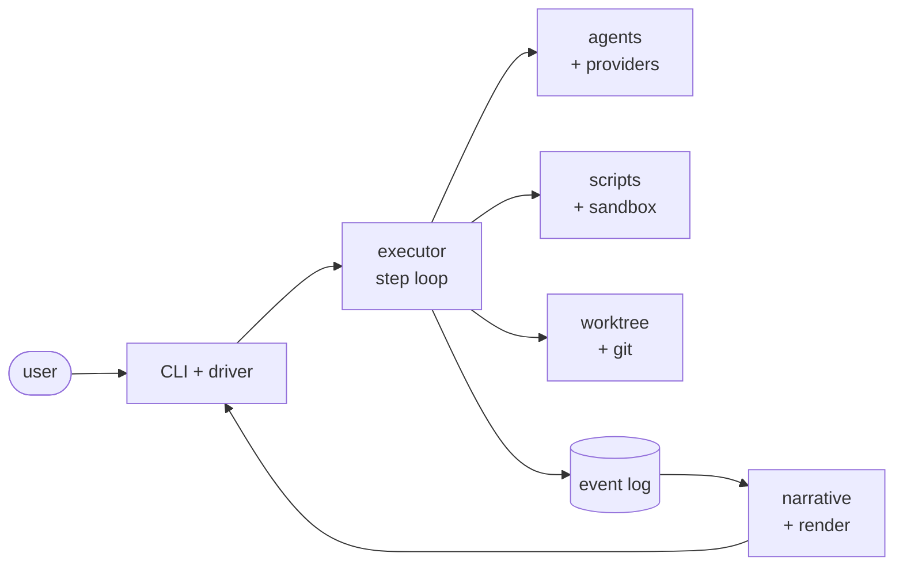

# imp

Coding agents are becoming **loops** — systems that run themselves, deciding what
to do next and when they're done. Most loops trend toward something you can't see
into: code written, reviewed, and maintained by a machine, in a form no human still
understands. The loop works until the day it doesn't, and then no one can say why.

**imp is the loop made legible.** A deterministic engine drives a declarative
workflow; the model is summoned one step at a time with fresh, tightly-scoped
context. The path is written down, every byte is logged, and the human stays at the
controls — approving, redirecting, or stopping the work at gates that are part of
the design, not bolted on.

You work at the level of **intent**. imp owns the mechanism: spec, plan, implement,
review, integrate — each step isolated, auditable, and resumable, in its own git
worktree, until it reaches you for a decision. It's the difference between software
as a machine you understand and software as an organism you can only treat the
symptoms of.

## Intent-driven development

You describe *what* you want changed and *why*. imp owns the *how* — the mechanism
of turning that intent into a reviewed, integrated change. You are not prompting a
chat window and hoping; you state intent and approve the result at points you
control.

The distinction is the whole stance. The alternative is software as an organism:
grown rather than built, understood by no one, kept alive by treating symptoms.
Intent-driven development keeps software a machine — something you direct, inspect,
and can still reason about after the agent has done its work.

## How it works

imp is a **deterministic engine** driving a **declarative workflow**. The engine
decides nothing about your code; it sequences steps, routes on their results, and
records everything. The model is summoned one step at a time, each invocation handed
fresh, tightly-scoped context — never the accumulated sprawl of one long chat
session.

Every change moves through the same lifecycle — **spec → plan → implement → review →
integrate** — in its own git worktree. Human gates sit at the phase boundaries by
design: imp runs autonomously between them and stops at the points where your
judgment matters.

Underneath it all, an append-only **event log is the single source of truth**: every
step, tool call, and decision is recorded per change. State is a cursor rebuilt from
the log, so a run can pause mid-step or crash and resume without losing the thread —
and the same log renders both the live view and `imp log` after the fact.

## What it's for

Each pain below is something experienced engineers already distrust about coding
agents. imp's answer to each is structural, not a promise.

- **Context drift in long sessions.** Roughly 65% of agent failures trace to context
  that has drifted from the task. imp hands every step fresh, tightly-scoped context
  by construction, so there is no long session to drift.
- **Unauditable agents.** Every byte of every run is logged per change; the event log
  is the source of truth, not a side effect you hope was captured.
- **Unreviewed drift to production.** Work runs autonomously only up to a gate, and
  each change is isolated in its own worktree until you approve it.
- **Opacity and loss of comprehension.** A declarative workflow plus the
  event-log-as-truth keep a run legible; an intent-level per-change summary (delivered
  by separate work) lets you read what happened at the level you care about.
- **Defensive-code amplification.** The workflow's coding stance pushes back on the
  reflexive fallbacks and dead error-handling agents tend to pile up (hardened by
  separate work).
- **Vendor lock-in.** Model selection is per role, and the engine can run different
  roles on different vendors in a single run (see Highlights).
