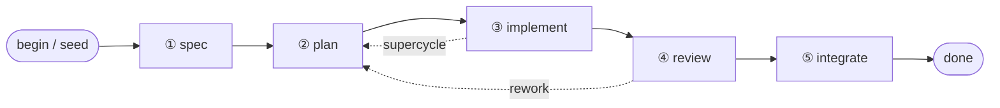

# imp

Coding agents are becoming **loops** — systems that run themselves, deciding what
to do next and when they're done. Most loops trend toward something you can't see
into: code written, reviewed, and maintained by a machine, in a form no human still
understands. The loop works until the day it doesn't, and then no one can say why.

**imp is the loop made legible.** A deterministic engine drives a declarative
workflow; the model is summoned one step at a time with fresh, tightly-scoped
context. The path is written down, every byte is logged, and the human stays at the
controls — approving, redirecting, or stopping the work at gates that are part of
the design, not bolted on.

You work at the level of **intent**. imp owns the mechanism: spec, plan, implement,
review, integrate — each step isolated, auditable, and resumable, in its own git
worktree, until it reaches you for a decision. It's the difference between software
as a machine you understand and software as an organism you can only treat the
symptoms of.

## Intent-driven development

You describe *what* you want changed and *why*. imp owns the *how* — the mechanism
of turning that intent into a reviewed, integrated change. You are not prompting a
chat window and hoping; you state intent and approve the result at points you
control.

The distinction is the whole stance. The alternative is software as an organism:
grown rather than built, understood by no one, kept alive by treating symptoms.
Intent-driven development keeps software a machine — something you direct, inspect,
and can still reason about after the agent has done its work.

## How it works

imp is a **deterministic engine** driving a **declarative workflow**. The engine
decides nothing about your code; it sequences steps, routes on their results, and
records everything. The model is summoned one step at a time, each invocation handed
fresh, tightly-scoped context — never the accumulated sprawl of one long chat
session.


Every change moves through the same lifecycle — **spec → plan → implement → review →
integrate** — in its own git worktree. Human gates sit at the phase boundaries by
design: imp runs autonomously between them and stops at the points where your
judgment matters.



Underneath it all, an append-only **event log is the single source of truth**: every
step, tool call, and decision is recorded per change. State is a cursor rebuilt from
the log, so a run can pause mid-step or crash and resume without losing the thread —
and the same log renders both the live view and `imp log` after the fact.

## What it's for

Each pain below is something experienced engineers already distrust about coding
agents. imp's answer to each is structural, not a promise.

- **Context drift in long sessions.** Roughly 65% of agent failures trace to context
  that has drifted from the task. imp hands every step fresh, tightly-scoped context
  by construction, so there is no long session to drift.
- **Unauditable agents.** Every byte of every run is logged per change; the event log
  is the source of truth, not a side effect you hope was captured.
- **Unreviewed drift to production.** Work runs autonomously only up to a gate, and
  each change is isolated in its own worktree until you approve it.
- **Opacity and loss of comprehension.** A declarative workflow plus the
  event-log-as-truth keep a run legible; an intent-level per-change summary (delivered
  by separate work) lets you read what happened at the level you care about.
- **Defensive-code amplification.** The workflow's coding stance pushes back on the
  reflexive fallbacks and dead error-handling agents tend to pile up (hardened by
  separate work).
- **Vendor lock-in.** Model selection is per role, and the engine can run different
  roles on different vendors in a single run (see Highlights).

## Highlights

- **Drive a run from your phone.** imp can stream a run's events to a chat surface
  (Telegram out of the box) and accept your replies back, so you can watch and steer a
  change from anywhere — not only the terminal you launched it from.
- **Pause and resume mid-call.** A run can be interrupted in the middle of a model
  call — ESC, a signal, or a watchdog — and resumed later from the event log without
  discarding the in-flight step.
- **Per-role, multi-vendor model selection.** You choose your provider(s). The engine
  resolves each role to a configured provider and model, and a multi-vendor config can
  run different roles on different vendors in one run — for example the coder on one
  vendor and the reviewer on another. This is a capability you configure, not the default:
  the shipped workflow gets reviewer independence by model *tier* within a single
  provider, so splitting roles across vendors is opt-in.

## Quickstart

imp is a Python package (requires Python 3.11+). It is pre-release; install from a
clone for now.

### Install

```bash
git clone <repo-url> imp && cd imp
python3 -m pip install -e .
imp init          # set up imp in your project (git, imp/project.yaml, config)
```

### Start a change

```bash
imp new "add rate limiting to the public API"   # state your intent; imp drives the workflow
imp log                                          # read the narrative for the latest change
imp resume                                       # resume a paused or interrupted change
```

You stay at the controls: imp runs autonomously between gates and stops for your
decision at the spec, plan, and merge boundaries.

### Drive a run remotely

imp can stream a run's events to an external chat surface and accept replies back —
so you can watch and drive `imp new` from your phone. Enable exactly one built-in
driver by name in your machine's `~/.config/imp/config.yaml`:

```yaml
remote:
  driver: telegram          # bare name; or a mapping with knob overrides:
  # driver:
  #   name: telegram
  #   events: [all]             # or an explicit event-type allowlist
  #   startup_timeout: 10
```

Credentials stay in the environment (never in config). Built-ins:

| Driver | Description | Required env |
|--------|-------------|--------------|
| `telegram` | Drive an imp run from a Telegram chat (outbound getUpdates; stdlib-only). | `IMP_TELEGRAM_TOKEN`, `IMP_TELEGRAM_CHAT_ID` |

Run `imp config` to see the available drivers and which one is enabled.

#### Telegram setup

1. Create a bot with [@BotFather](https://t.me/BotFather) and copy its token. A bot
   token has the form `<id>:<auth>` — exactly **one** colon. Pasting any extra
   suffix makes every API call fail.
2. Open your new bot in Telegram and send it `/start` (or any message). A bot can
   only message a chat that has messaged it first.
3. Find your numeric chat id (e.g. message [@userinfobot](https://t.me/userinfobot)),
   then export both credentials:

   ```bash
   export IMP_TELEGRAM_TOKEN=123456789:AA...      # <id>:<auth>, one colon
   export IMP_TELEGRAM_CHAT_ID=987654321          # your numeric chat id
   ```

A run validates these once at startup (a `getMe` / `getChat` self-check). A rejected
token or unreachable chat is reported at **WARNING** with a fix hint — otherwise a
broken credential fails silently and no notifications arrive. The driver's other
diagnostics stay quiet unless you enable debug logging for the `imp.remote` logger.
