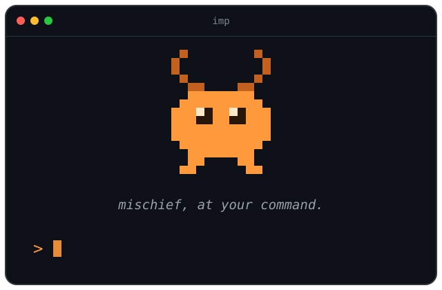

# Trademarks

imp is available under the [MIT License](LICENSE), and we encourage people to
use, copy, modify, distribute, and build on it in accordance with that
license.

The MIT License governs the rights in the software.  It does not grant
permission to use our trademarks, service marks, logos, trade names, or other
brand features as trademarks or source identifiers.

You may use the Marks in ways that truthfully identify or refer to us, our
project, or our software, provided that your use does not create a likelihood
of confusion regarding the source, sponsorship, affiliation, approval,
certification, or endorsement of your product, service, project,
organization, or activity.

The goal is simple: people should always be able to tell whether something is
the real imp.  It should be clear what you are providing, who is providing it,
and what relationship, if any, you have with us.

## Our marks

These are trademarks of Josh Poimboeuf ("we" in this Policy), collectively the
"Marks":

- **imp™** — the Word Mark, as used for this software and related products
  and services
- **the imp Logo™** — the orange pixel-art imp shown below
- **mischief, at your command.™** — the imp Slogan

imp's terminal splash screen, showing the Word Mark, Logo, and Slogan:

  

This Policy doesn't claim the ordinary English word "imp", Python's former
`imp` module, or unrelated projects that share the name.

## Allowed without asking

- **Referring to imp** — articles, talks, tutorials, comparisons, reviews, and
  saying a project was "built with imp".
- **Compatibility** — saying something "works with imp", or describing "an imp
  workflow for Django".
- **Add-ons** — workflows, skills, provider plugins, and tools named in the
  "Foo for imp" or `imp-foo` style, as long as it's clear they're unofficial.
- **Unmodified redistribution** — distributing imp unmodified, or with only
  packaging changes or minor bug-fix patches, under the imp name (for example
  in a Linux distribution or Homebrew).
- **Linking and illustration** — using the unmodified Logo to link to or
  illustrate the real imp project, such as in a blog post, slide deck, or
  "built with imp" badge.  Redrawn versions of the Logo in fan art or
  illustrations are fine too.
- **Community** — free, non-commercial user groups and meetups, and
  merchandise you make for yourself or give away.

## Ask first

- Using "imp" in the name or branding of your own product, service, company,
  or hosted offering.  You may use our Word Mark descriptively to identify
  compatibility or relationship to our software, provided your own branding is
  clearly dominant.  "Bob's agent runner for imp" is fine; "Bob's imp" needs
  permission.
- Domain names or social accounts that use "imp" as the project's identity.
- Selling merchandise that carries the Marks.

## Not allowed

- **Forks and modified versions** — if you distribute a fork, or a version
  modified beyond packaging changes or minor bug-fix patches, give it a
  different name and drop the Word Mark, Logo, and Slogan.  You may say it is
  "derived from imp".
- **Using the Logo as your own** — as the logo, icon, or avatar of anything
  other than the real imp project, including forks, add-ons, and accounts,
  whether modified or not.
- **False endorsement or confusing names** — anything suggesting endorsement
  or official status that doesn't exist, or names confusingly similar to imp,
  including "Imp Pro", "OpenImp", or a competing agent-workflow tool branded
  around imp's distinctive vocabulary such as "quests".  A disclaimer doesn't
  make a confusing name acceptable.

## Asking permission

Email [josh@implab.ai](mailto:josh@implab.ai) describing what you'd like to do,
or with any questions about this Policy.  If you're not sure whether your use
is covered, ask.

All rights in the Marks remain with us.  This Policy is not intended to
restrict any use of the Marks that is permitted by applicable law.

Beyond the uses allowed above, nothing in this Policy transfers ownership of
any Mark or grants you a right to register a trademark, service mark, domain
name, company name, package name, application name, social-media identifier,
or other identifier that is identical or confusingly similar to one of our
Marks.

To the extent permitted by law, goodwill arising from any permitted use of our
Marks inures to our benefit.

## Reporting misuse

If you become aware of a use of our Marks that may cause confusion or falsely
suggest affiliation, sponsorship, approval, endorsement, certification,
authorization, or official status, we welcome notice at
[josh@implab.ai](mailto:josh@implab.ai).

## Updates to this Policy

We may update this Policy from time to time.  Changes to this Policy do not
modify the MIT License or alter rights previously granted under the MIT
License with respect to the software.

---

This Policy is adapted from the [Model Trademark
Guidelines](https://modeltrademarkguidelines.org), used under the [Creative
Commons Attribution 4.0 International
license](https://creativecommons.org/licenses/by/4.0/).
