# imp architecture

Two views, each layered: a small **overview** you can read at a glance, then **zoom-in** diagrams that stay legible when printed.

- [Engine architecture](#engine-architecture) — overview + 5 lane zoom-ins
- [Default workflow](#default-workflow) — overview + 5 phase zoom-ins

> Diagrams are [Mermaid](https://mermaid.js.org/). GitHub renders them inline; in an editor use a Mermaid preview extension. Each fenced block is sized to print on its own.

---

## Engine architecture

A single **change** is one unit of work: an isolated git worktree on an `imp/<id>` branch, driven through a workflow by the executor. The executor runs a step loop — each step is an *agent*, *script*, *branch* (router), or *merge* — and every step appends to an append-only event log that is the source of truth for both crash recovery and rendering.

### Overview

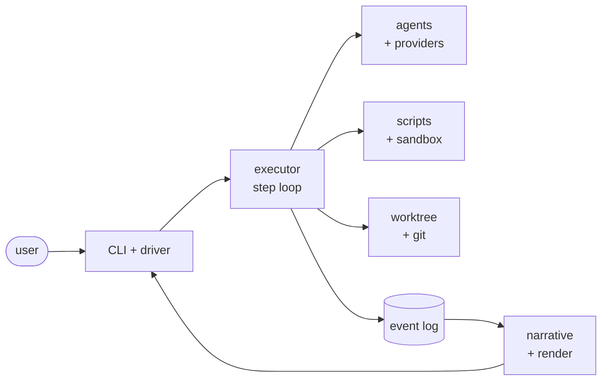

The four lanes off the executor (agents, scripts, git, log→render) are detailed below.

### Zoom 1 — executor & step loop

The loop loads the workflow once, then for each step dispatches by `kind`, evaluates the step's rules against the current `vars`, and routes. State is a derived cursor; the event log is the truth.

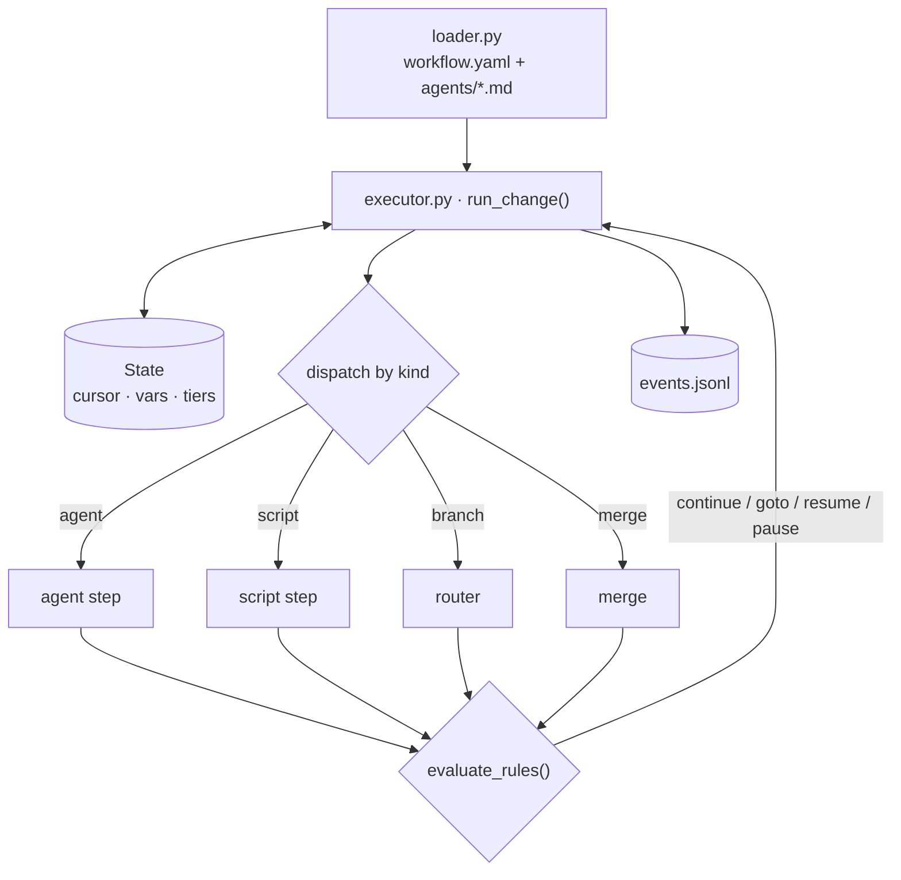

### Zoom 2 — agent & provider lane

`agent_run.drive_invocation()` resolves the step's tier to a concrete `(provider, model)`, drives the provider's `AgentRunner`, and dispatches tools. Tools can spawn subagents (implementer, reviewers), which re-enter the same drive loop one level down.

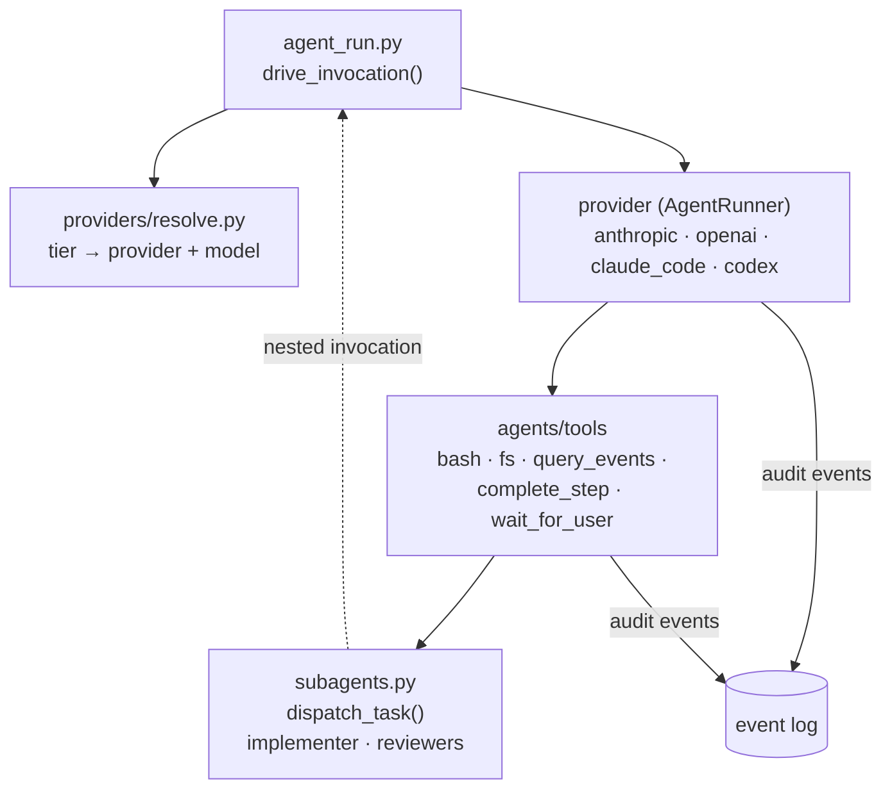

### Zoom 3 — scripts & sandbox

Script steps and the `bash`/`fs` tools both run under one bubblewrap policy (baked once at run start, `IMP_*` env injected per spawn). A script routes on its exit code.

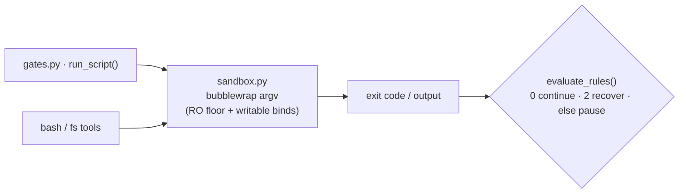

### Zoom 4 — worktree & git

All git mechanics sit behind `worktree.py`. The final merge is lock-protected; completed changes are preserved on an orphan journal ref even after the worktree is pruned.

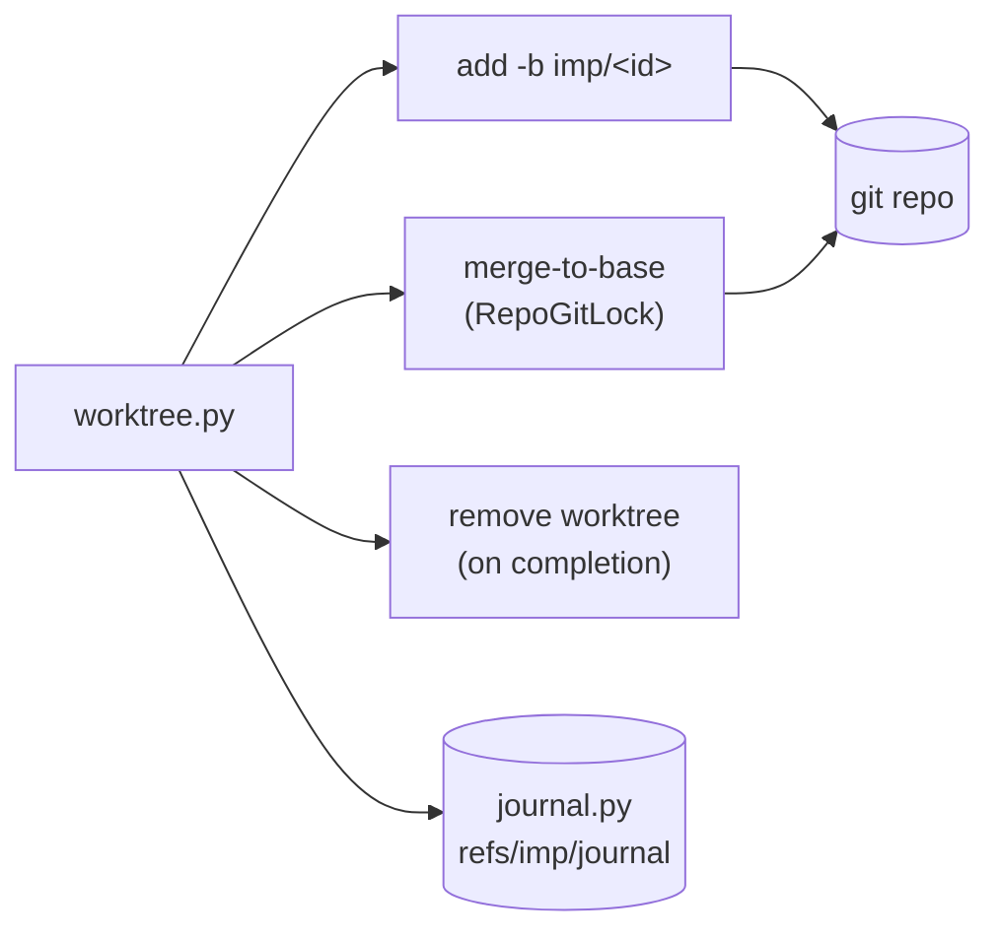

### Zoom 5 — rendering (live & `imp log`)

One event→tree fold feeds both the live view and `imp log`, so they can't diverge.

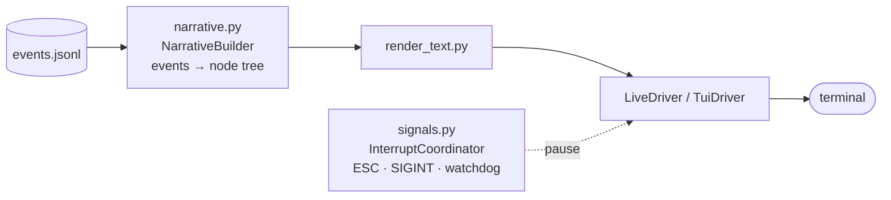

### Component reference

| Layer | Module(s) | Role |
|---|---|---|
| Entry / drivers | `cli/main.py`, `cli/live_driver.py`, `cli/tui_app.py` | Command dispatch; live / TUI / headless rendering + signal wiring around `run_change`. |
| Executor | `engine/executor.py` | Step loop: load → resolve providers → dispatch → route. Returns `COMPLETED \| PAUSED \| ERRORED`. |
| Change / state | `engine/change.py`, `engine/state.py` | Per-run identity + worktree; execution cursor, vars, resolved tiers (atomic `save()`); append-only `EventLog`. |
| Workflow load | `engine/loader.py`, `engine/types.py` | Parse `workflow.yaml` + `agents/*.md` into a frozen `Workflow` (phases → steps, agents, vars, rules). |
| Step dispatch | `engine/gates.py`, `engine/expr.py` | `run_script()` (sandboxed commands) + `evaluate_rules()` (Continue / Retry / Pause / Goto + var mutations). |
| Sandbox | `engine/sandbox.py` | Bubblewrap policy baked once; `IMP_*` env injected per spawn. |
| Providers | `providers/*.py`, `providers/resolve.py` | `resolve_run()` maps tiers→(provider, model) once per run; each provider implements the `AgentRunner` protocol. |
| Agent drive / tools | `engine/agent_run.py`, `agents/runner.py`, `agents/tools/*` | Build `AgentInvocation`, consume the event stream, dispatch per-agent allowlisted tools (incl. synthesized `complete_step`, `wait_for_user`). |
| Subagents | `agents/subagents.py`, `agents/dispatch.py` | `dispatch_task()` spawns child invocations with depth + parent-event threading. |
| Git | `engine/worktree.py`, `engine/journal.py` | Worktree create/remove, lock-protected merge-to-base, `refs/imp/journal`. |
| Rendering | `cli/narrative.py`, `cli/render_text.py` | One event→tree fold shared by live view and `imp log`. |
| Control plane | `engine/signals.py`, `engine/recovery.py` | Interrupt/pause + watchdog; gate-safe rewind for `imp resume --from`. |

**Invariants:** the event log is the single source of truth (state is a rebuildable cursor); the same `NarrativeBuilder` path renders both live and `imp log`.

---

## Default workflow

Defined in `src/imp/assets/workflows/default/workflow.yaml` (workflow name: **feature**). Five phases, with a per-task loop inside *implement* and a **supercycle** when a spec needs more than one plan. A `fast_path` (trivial spec) skips review/supercycle gates.

### Overview

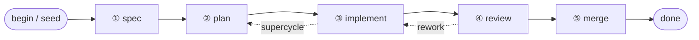

Step kinds across all phases:

- **agent** (boxes) — an LLM agent (`agents/<name>.md`); routes on its validated structured output.
- **script** (`{{ }}` hexagons) — a shell command (`scripts/*.sh`); routes on exit code (`0` continue, `2` recoverable, else **pause to human**).
- **branch** (`{ }` diamonds) — a pure var router, no execution.
- **merge** — engine-native, lock-protected merge to base.

Routing verbs: `continue`, `goto <step>`, `resume <step>` (re-enter with feedback), `pause` (human).

### Phase ① spec

Brainstorm → name the change → write+commit the spec, verify it committed, then optionally review (skipped on a user-confirmed gate or a trivial `fast_path`).

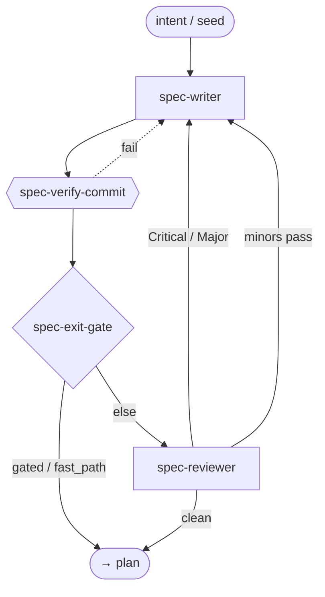

### Phase ② plan

Write the next bite-sized `plan-N`, verify the commit, then review (skipped on `fast_path`). Mirrors the spec loop.

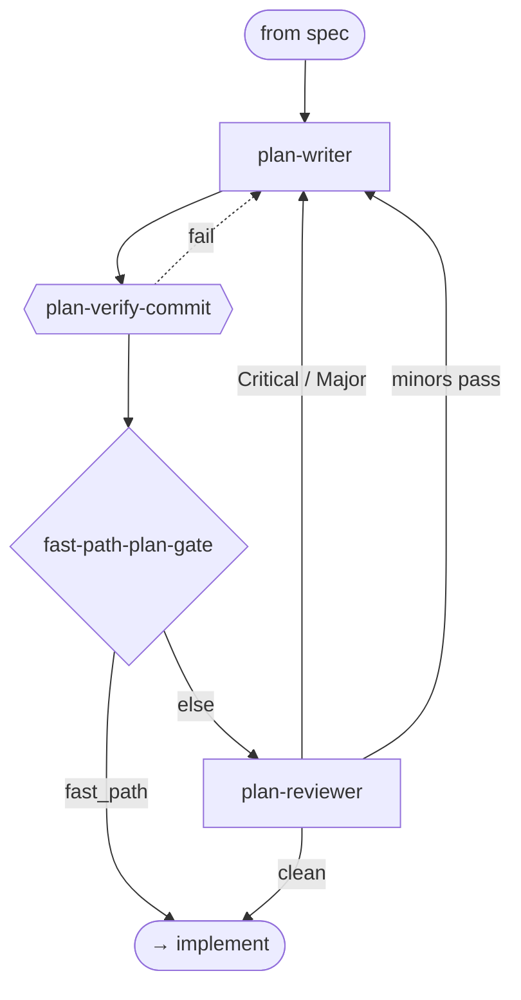

### Phase ③ implement

`task-lead` drives one task at a time (dispatching `implementer` + `quality-reviewer`), committing a clean unit each loop. After all tasks: verify, autosquash fixups, stamp trailers, run the 4-slice review panel, drain deferred followups, then decide whether the spec needs another plan (supercycle).

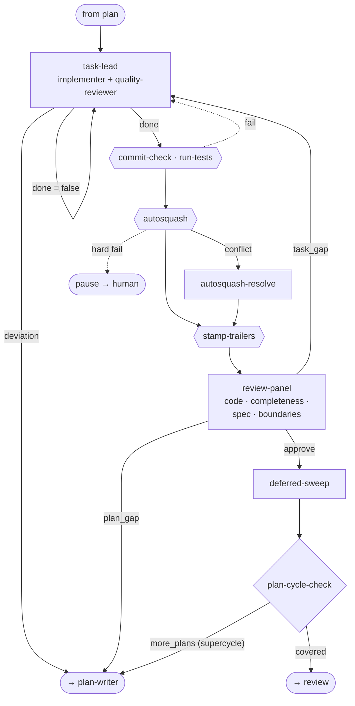

### Phase ④ review (end-of-change)

For multi-plan changes only: a trimmed whole-diff integration pass and cross-plan sweep, then merge base→branch (`integrator` resolves conflicts, `integration-review` verifies), a structured summary, and the interactive `final-review` human gate.

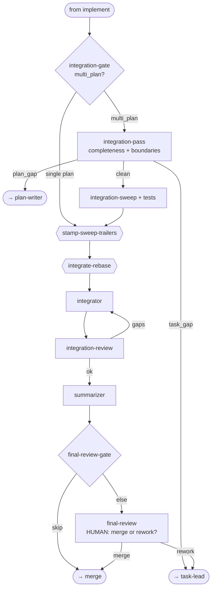

### Phase ⑤ merge

A cheap freshness check, then the lock-protected engine-native merge. If base moved, loop back to re-integrate.

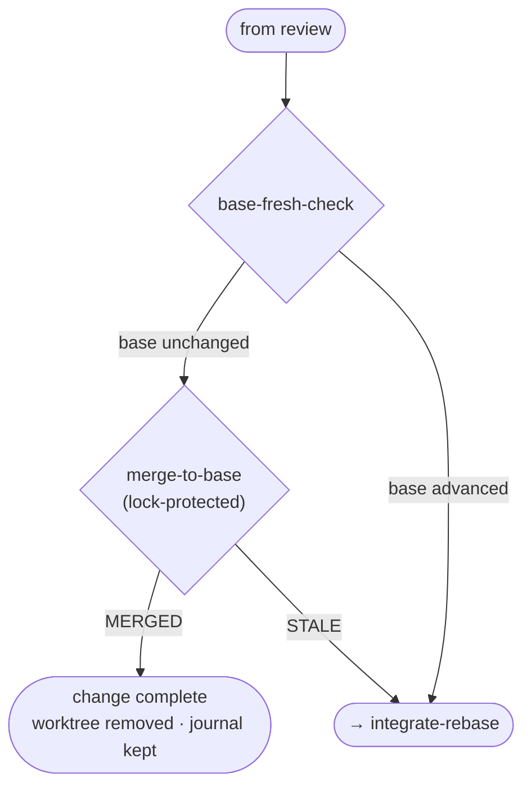

### Agent reference

| Agent | Tier | Role |
|---|---|---|
| `spec-writer` | high | Brainstorm with user, name the change, write+commit the spec. |
| `spec-reviewer` | high | Review spec vs captured intent; blocking iff Critical/Major. |
| `plan-writer` | high | Write the next bite-sized `plan-N` from spec + progress. |
| `plan-reviewer` | high | Review plan for coverage, placeholders, type consistency. |
| `task-lead` | medium | Implement controller: pick task, dispatch implementer + reviewer, adjudicate, commit one unit, record progress. |
| `implementer` | medium | Implement one task / apply directed fixes; commit. |
| `quality-reviewer` | medium | Per-task read-only quality review back to task-lead. |
| `review-panel` | medium | Whole-diff coordinator; dispatches the four slices, collapses verdicts, routes approve / task_gap / plan_gap. |
| `code-reviewer` | high | Generalist whole-change review vs spec (correctness + completeness). |
| `completeness-slice` | high | Every changed symbol's callers and parallel paths. |
| `spec-compliance-slice` | high | Does the code do exactly what the spec/task says. |
| `boundaries-slice` | high | Edge cases: empty/None/overflow, error handling at extremes. |
| `plan-cycle-check` | medium | Decide if the spec needs another plan (supercycle) or is covered. |
| `deferred-sweep` | medium | Drain deferred followups with a 3-way disposition (silent / fix+FYI / surface). |
| `autosquash-resolve` | high | Resolve a fixup-fold rebase conflict, preserving the pre-squash tree. |
| `integrator` | high | Merge base into the branch; resolve textual + semantic conflicts. |
| `integration-reviewer` | high | Verify the integrator's merge: no lost work, no silent breakage. |
| `summarizer` | high | Structured end-of-change summary (queryable via `imp log`). |
| `final-review` | medium | Interactive human gate: show summary, take comments, route merge vs rework. |

### Data files

| File | Written by | Read by |
|---|---|---|
| `imp/specs/{slug}.md` | spec-writer | all phases |
| `imp/plans/{slug}-plan-N.md` | plan-writer | task-lead, plan-cycle-check, deferred-sweep, integration-reviewer |
| `.imp/change/progress.md` | task-lead, deferred-sweep | all implement/review steps (tasks, commit subjects, deferred followups) |
| `.imp/change/integration-notes.md` | integrator | integration-reviewer, summarizer |
