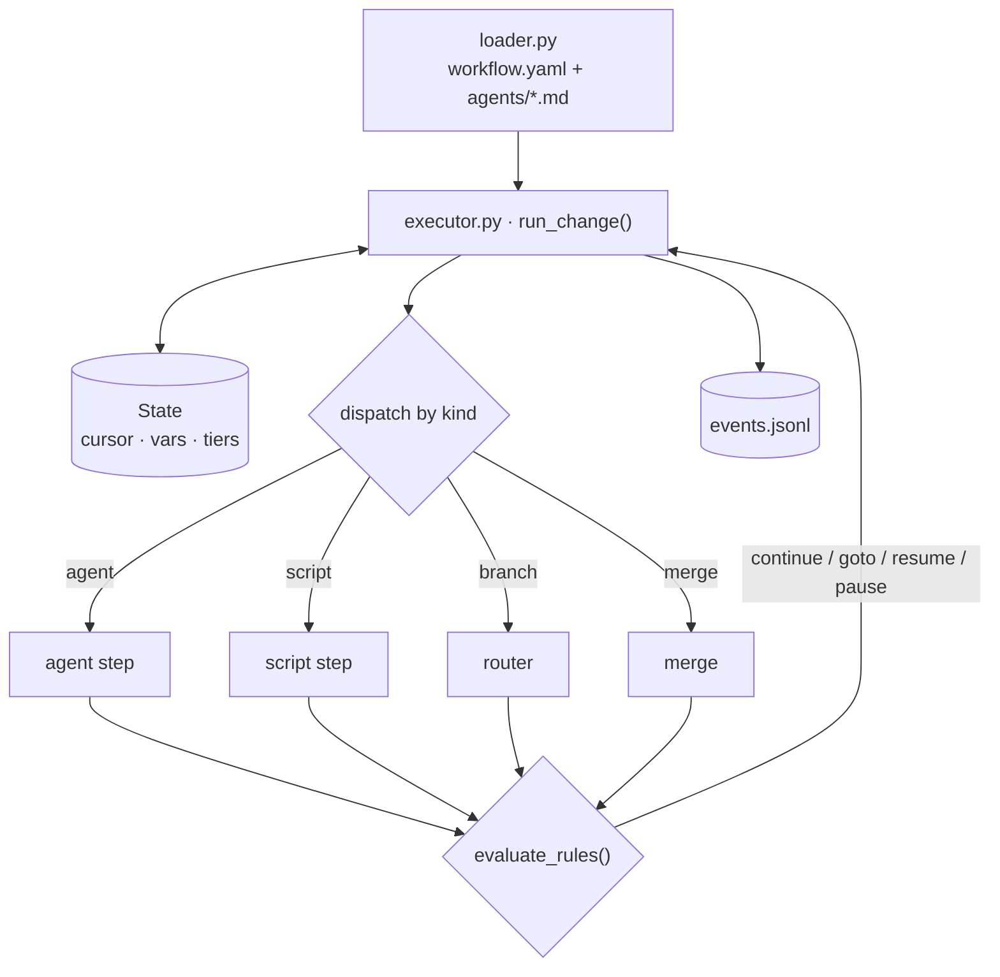
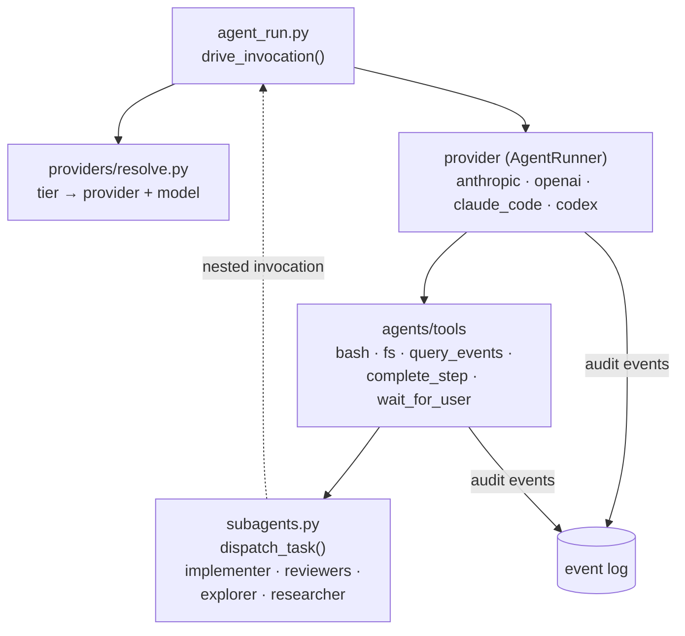
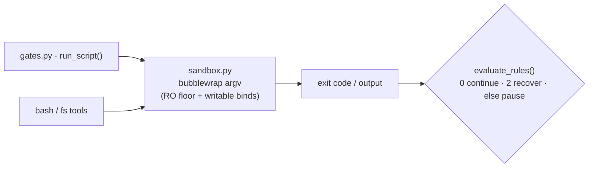
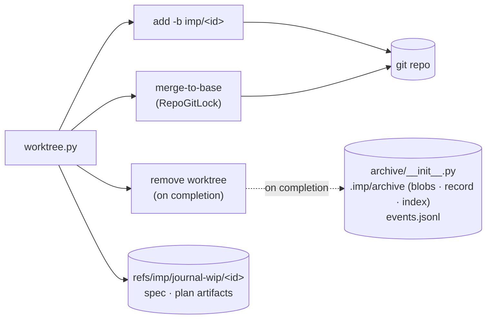
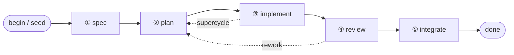
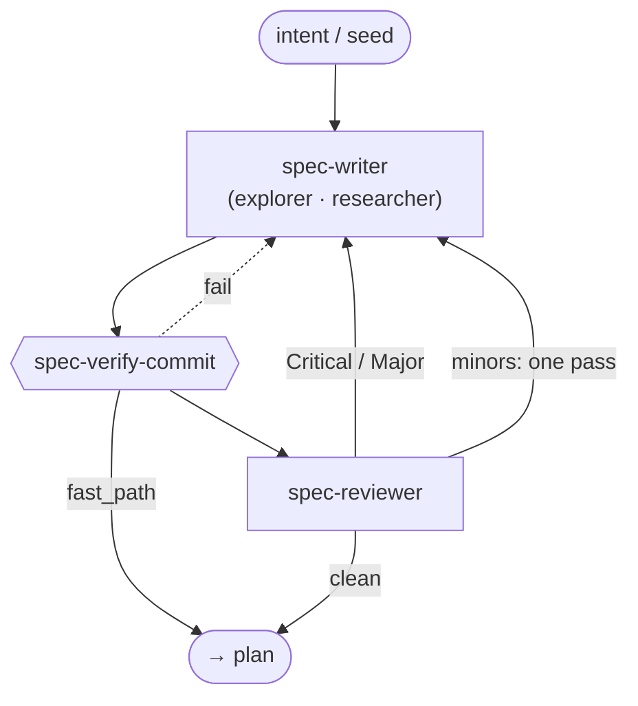
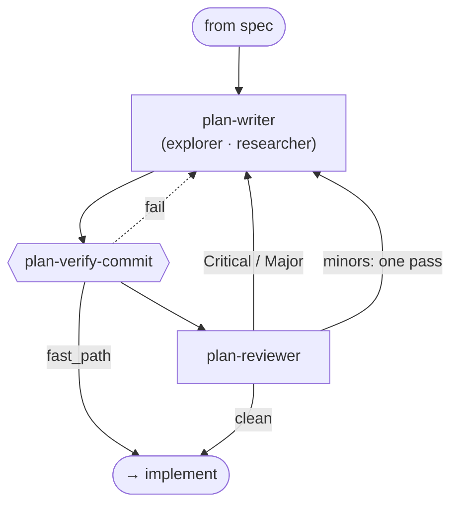
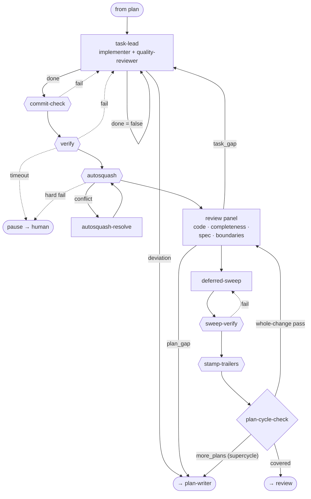
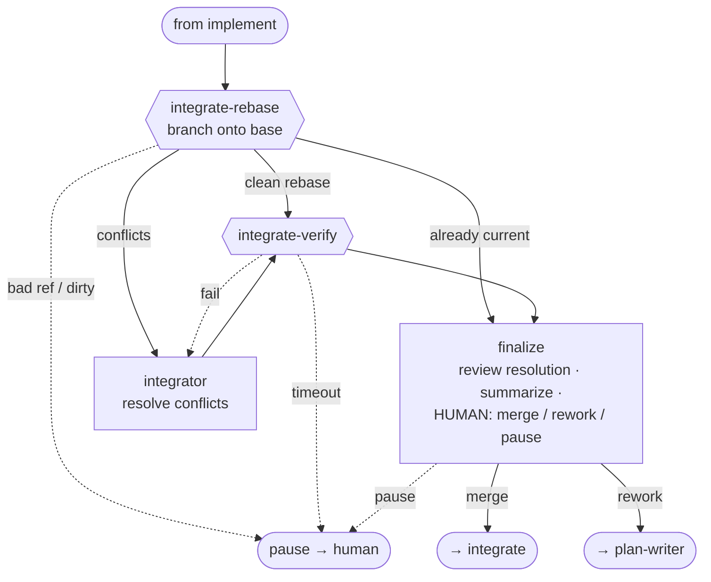
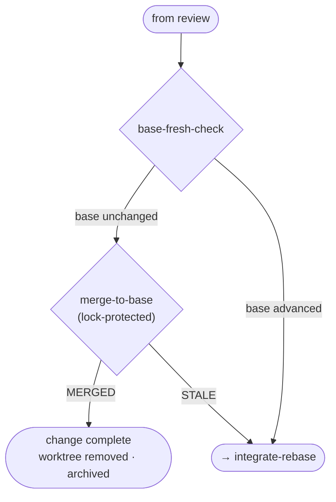

# imp architecture

## Engine architecture

A single **change** is one unit of work: an isolated git worktree on an `imp/<id>` branch, driven through a workflow by the executor. The executor runs a step loop — each step is an *agent*, *script*, *branch* (router), or *merge* — and every step appends to an append-only event log that is the source of truth for both crash recovery and rendering.

### Overview

The four lanes off the executor (agents, scripts, git, log→render) are detailed below.

### Zoom 1 — executor & step loop

The loop loads the workflow once, then for each step dispatches by `kind`, evaluates the step's rules against the current `vars`, and routes. State is a derived cursor; the event log is the truth.

### Zoom 2 — agent & provider lane

`agent_run.drive_invocation()` resolves the step's tier to a concrete `(provider, model)`, drives the provider's `AgentRunner`, and dispatches tools. Tools can spawn subagents (implementer, reviewers), which re-enter the same drive loop one level down.

### Zoom 3 — scripts & sandbox

Script steps and the `bash`/`fs` tools both run under one bubblewrap policy (baked once at run start, `IMP_*` env injected per spawn). A script routes on its exit code.

### Zoom 4 — worktree & git

All git mechanics sit behind `worktree.py`. Spec/plan artifacts live under `.imp/change/` (gitignored) and are committed to a per-change `refs/imp/journal-wip/<id>` ref as they're written. The final merge is lock-protected; at completion the change is archived — `events.jsonl` is content-addressed into a local blob store with an immutable record + SQLite index under `.imp/archive/` — so each change's events and artifacts survive even after the worktree is pruned (the `journal-wip` ref persists the artifacts; the archive persists the events).

### Zoom 5 — rendering (live & `imp log`)

One event→tree fold feeds both the live view and `imp log`, so they can't diverge.

### Component reference

| Layer | Module(s) | Role |
|---|---|---|
| Entry / drivers | `cli/main.py`, `cli/live_driver.py`, `cli/tui_app.py` | Command dispatch; live / TUI / headless rendering + signal wiring around `run_change`. |
| Executor | `engine/executor.py` | Step loop: load → resolve providers → dispatch → route. Returns `COMPLETED \| PAUSED \| ERRORED`. |
| Change / state | `engine/change.py`, `engine/state.py` | Per-run identity + worktree; execution cursor, vars, resolved tiers (atomic `save()`); append-only `EventLog`. |
| Workflow load | `engine/loader.py`, `engine/types.py` | Parse `workflow.yaml` + `agents/*.md` into a frozen `Workflow` (phases → steps, agents, vars, rules). |
| Step dispatch | `engine/gates.py`, `engine/expr.py` | `run_script()` (sandboxed commands) + `evaluate_rules()` (Continue / Retry / Pause / Goto + var mutations). |
| Sandbox | `engine/sandbox.py` | Bubblewrap policy baked once; `IMP_*` env injected per spawn. |
| Providers | `providers/*.py`, `providers/resolve.py` | `resolve_run()` maps tiers→(provider, model) once per run; each provider implements the `AgentRunner` protocol. |
| Agent drive / tools | `engine/agent_run.py`, `agents/runner.py`, `agents/tools/*` | Build `AgentInvocation`, consume the event stream, dispatch per-agent allowlisted tools (incl. synthesized `complete_step`, `wait_for_user`). |
| Subagents | `agents/subagents.py`, `agents/dispatch.py` | `dispatch_task()` spawns child invocations with depth + parent-event threading. |
| Git | `engine/worktree.py`, `engine/archive/` | Worktree create/remove, lock-protected merge-to-base, per-change `journal-wip` artifact ref; at completion the change is archived (content-addressed `events.jsonl` blob + immutable record + SQLite index under `.imp/archive/`). |
| Workflow assets | `assets/__init__.py` | Bundled workflows ship with the install; `resolve_workflow_dir` lets a committed `imp/workflows/<name>` override a bundled one. |
| Rendering | `cli/narrative.py`, `cli/render_text.py` | One event→tree fold shared by live view and `imp log`. |
| Control plane | `cli/signals.py`, `engine/recovery.py`, `providers/errors.py` | Interrupt/pause + watchdog; typed error categories incl. a first-class *terminated*; gate-safe rewind and continue-nudge transcript replay for `imp resume`. |
| Live drivers | `engine/drivers.py`, `engine/selfhost.py` | Per-agent live-driver capability (`drivers:` frontmatter, e.g. `impty`): stdio MCP servers granted to an agent, launched self-hosted. |

**Invariants:** the event log is the single source of truth (state is a rebuildable cursor); the same `NarrativeBuilder` path renders both live and `imp log`.

---

## Default workflow

Defined in `src/imp/assets/workflows/imp/workflow.yaml` (workflow name: **feature**; bundled with the install — a committed `imp/workflows/imp` overrides it, see the [component reference](#component-reference)). Five phases, with a per-task loop **and** a per-plan review panel inside *implement*, and a **supercycle** when a spec needs more than one plan. A `fast_path` (trivial spec) skips the review/supercycle gates.

### Overview

Step kinds across all phases:

- **agent** (boxes) — an LLM agent (`agents/<name>.md`); routes on its validated structured output.
- **script** (`{{ }}` hexagons) — a shell command (`scripts/*.sh`); routes on exit code (`0` continue, `2` recoverable, else **pause to human**).
- **branch** (`{ }` diamonds) — a pure var router, no execution.
- **merge** — engine-native, lock-protected merge to base.

Routing verbs: `continue`, `goto <step>`, `resume <step>` (re-enter with feedback), `pause` (human).

### Phase ① spec

Brainstorm with the user (optionally dispatching read-only `explorer`/`researcher` helpers) → name the change → write the spec under `.imp/change/artifacts/spec/` and commit it to the change's journal-wip ref, verify it committed, then review. A trivial `fast_path` skips the reviewer; otherwise the reviewer gets the last word — the loop ends only on a clean verification review with nothing left to integrate.

### Phase ② plan

Write the next bite-sized `plan-N` (same read-only helper subagents), verify the commit, then a single **`plan-reviewer`** runs directly, reading the plan's prescribed code like a diff. `fast_path` skips review. Mirrors the spec minors loop.

### Phase ③ implement

`task-lead` drives one task at a time (dispatching `implementer` + `quality-reviewer`), committing a clean unit each loop. After all tasks: `commit-check`, then `verify` (the project's own test/lint gate — a gate **timeout** pauses to a human rather than looping), autosquash fixups into one-commit-per-task, run the 4-slice review panel, drain deferred followups, re-verify, stamp trailers, then `plan-cycle-check` decides whether the spec needs another plan (supercycle). After the last plan of a multi-plan change it routes once more through the panel for a **whole-change pass** (`review_scope=change`) before the review phase.

### Phase ④ review (end-of-change)

Rebase the branch onto base (`integrate-rebase`); on conflicts the `integrator` agent resolves them and `integrate-verify` re-runs the test gate. Then `finalize` **always** runs: it reviews the base-merge resolution with independent eyes (when one occurred), writes the structured end-of-change summary (queryable via `imp log`), and is the interactive human gate — merge, rework, or pause.

### Phase ⑤ integrate

A cheap freshness check, then the lock-protected engine-native merge. If base moved, loop back to re-integrate.

### Agent reference

| Agent | Tier | Role |
|---|---|---|
| `spec-writer` | high | Brainstorm with user, name the change, write+commit the spec. |
| `spec-reviewer` | high | Review spec vs captured intent; blocking iff Critical/Major. |
| `plan-writer` | high | Write the next bite-sized `plan-N` from spec + progress. |
| `plan-reviewer` | high | Run directly as the `plan-review` step. Review the newest plan's prescribed code like a diff; blocking iff Critical/Major. |
| `task-lead` | medium | Implement controller: pick task, dispatch implementer + reviewer, adjudicate, commit one unit, record progress. |
| `implementer` | medium | Implement one task / apply directed fixes; commit. |
| `quality-reviewer` | medium | Per-task read-only quality review back to task-lead. |
| `review-panel` | medium | Whole-diff coordinator; dispatches the four opus reviewers, dedupes/filters their advisory findings, routes approve / task_gap / plan_gap. |
| `code-reviewer` | high | Generalist whole-change review vs spec (correctness + completeness). |
| `completeness-slice` | high | Every changed symbol's callers and parallel paths. |
| `spec-compliance-slice` | high | Does the code do exactly what the spec/task says. |
| `boundaries-slice` | high | Edge cases: empty/None/overflow, error handling at extremes. |
| `deferred-sweep` | medium | Drain deferred followups with a 3-way disposition (silent / fix+FYI / surface); may dispatch implementer + quality-reviewer for fixes. |
| `plan-cycle-check` | medium | Decide if the spec needs another plan (supercycle) or is covered. |
| `autosquash-resolve` | high | Resolve a fixup-fold rebase conflict, preserving the pre-squash tree. |
| `integrator` | high | Merge base into the branch; resolve textual + semantic conflicts. |
| `finalize` | high | Final gate: review the base-merge resolution, write the end-of-change summary (queryable via `imp log`), and decide merge / rework / pause. |
| `explorer` | — | Read-only helper: fast codebase exploration with file:line citations (dispatched by spec-writer / plan-writer). |
| `researcher` | — | Read-only helper: web search + fetch (and codebase grounding), reports cited findings. |

### Data files

All four live under `.imp/change/` (gitignored); spec/plan artifacts are committed to the change's `journal-wip` ref (see *Zoom 4 — worktree & git*).

| File | Written by | Read by |
|---|---|---|
| `.imp/change/artifacts/spec/{slug}.md` | spec-writer | all phases |
| `.imp/change/artifacts/plans/{slug}-plan-N.md` | plan-writer | task-lead, plan-reviewer, plan-cycle-check, deferred-sweep, finalize |
| `.imp/change/progress.md` | task-lead, deferred-sweep | all implement/review steps (tasks, commit subjects, deferred followups) |
