# imp architecture

## Engine architecture

A single **quest** is one unit of work: an isolated git worktree on an `imp/<id>` branch, driven through a workflow by the executor. The executor runs a step loop — each step is an *agent*, *script*, *branch* (router), or *merge* — and every step appends to an append-only event log that is the source of truth for both crash recovery and rendering.

### Overview

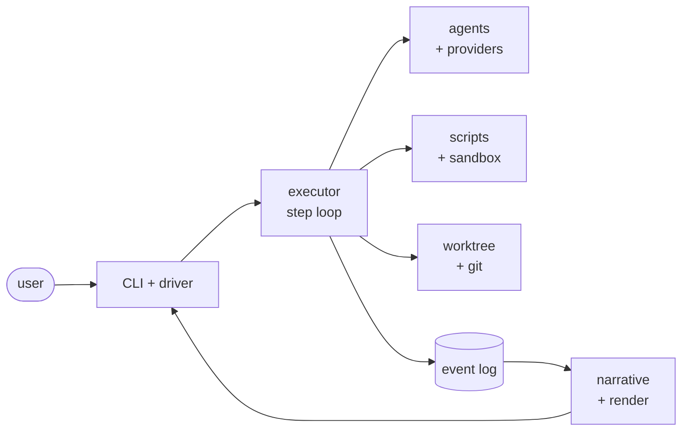

The four lanes off the executor (agents, scripts, git, log→render) are detailed below.

### Where state lives

A project's runtime state lives **outside** its checkout, in a per-project state directory: `~/.imp/projects/<slug>/` by default (`paths.py · project_state_dir()`). `<slug>` is the checkout's directory name, lowercased, with anything outside `[a-z0-9._-]` replaced by `-` and truncated to 64 characters; a `repo` marker file inside it names the checkout that claimed it, so a second checkout slugging to the same name claims `<slug>-2`. Read-only lookups — live quest listing, archive index reads, the remote-control pid, the local config layer — use `claimed_state_dir()` and see an unclaimed project as empty, so imp claims a slug only inside a project with `imp/config.yaml` or on a deliberate write. `$IMP_HOME` moves `~/.imp`; `$IMP_STATE_DIR` overrides the per-project path verbatim — no slug walk, no marker written — and `engine_env()` injects `$IMP_HOME` unconditionally and `$IMP_STATE_DIR` wherever it is given a control root — every policy bake — so both reach every agent subprocess, and resolution is identical inside the sandbox: a sandboxed agent inherits no ambient `IMP_*` except the names a project's `sandbox.env_passthrough` opts in, so what `engine_env()` does not emit and the config does not name does not exist there. Two directories sit outside that per-project layout. `~/.imp/diagnostics/` holds the machine-global read-fault log (`read-faults.jsonl`) and the preserved bad bytes (`bytes/`) written by `engine/readfault.py` — deliberately outside any quest home or project state dir, so the evidence outlives the quest that recorded it. `~/.imp/cache/quota/` is the disposable, machine-global quota cache (`cli/quota_cache.py`): one entry per quest holding only the raw quota facts read from its own log, keyed by an extract-format version plus the live log's size and mtime or the archived events blob's hash. Weeks, prices and metering are applied on read, so no entry goes stale when another quest or the price table changes, and deleting the directory costs only a recompute.

| Under the state directory | Holds |
|---|---|
| `quests/<id>/` | the quest home — `quest.json`, `state/`, `events.jsonl`, `artifacts/`, `spike/`, `progress.md`, the `workflow/` snapshot, and `pinned-src/`, holding the source snapshot of imp each session daemon runs from |
| `worktrees/<id>/` | the quest's git worktree, on branch `imp/<id>` |
| `archive/` | completed quests: content-addressed blobs, per-quest records, SQLite index |
| `config.yaml` | the local config layer (`imp config set --local`) |
| `outer-imp-warned` | the installed-copy path imp was last warned about running from (the run-start `outer imp mismatch` warning), so each project hears about a given install once |
| `remote-control.log`, `remote-control.pid` | the session daemon's files |

The checkout holds no imp state. A quest **worktree** holds exactly one imp path — the symlink `.imp/quests/<id>` pointing at that quest's home — which is why an agent running in a worktree still addresses its home by the unchanged worktree-relative path, and why `.imp/` is still gitignored. An agent running in the main checkout (a draft, before go-live) has no worktree and no symlink, so it is given the home's absolute path instead.

### Zoom 1 — executor & step loop

The loop loads the workflow once, then for each step dispatches by `kind`, evaluates the step's rules against the current `vars`, and routes. State is a derived cursor; the event log is the truth.

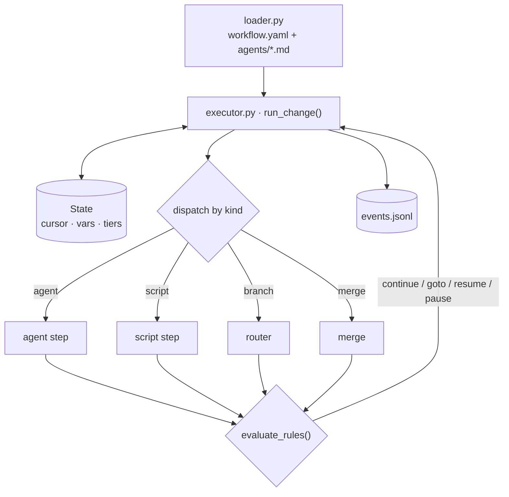

### Zoom 2 — agent & provider lane

`agent_run.drive_invocation()` resolves the step's tier to a concrete `(provider, model)`, drives the provider's `AgentRunner`, and dispatches tools. A step's tier itself is fixed at load time by `loader._parse_step`: the step's own `tier:` in `workflow.yaml`, else the referenced agent file's frontmatter `tier:`, else `medium`. Tools can spawn subagents (coder, code-reviewer), which re-enter the same drive loop one level down.

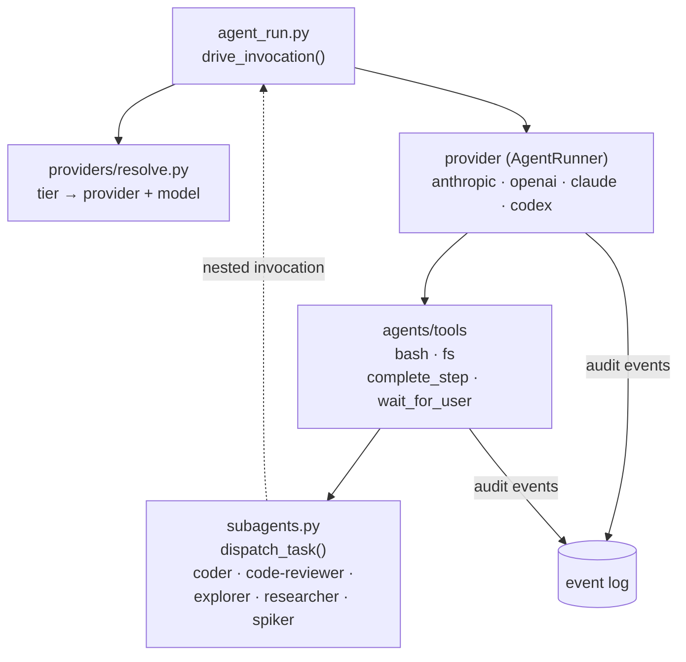

### Zoom 3 — scripts & sandbox

Script steps and the `bash`/`fs` tools both run under one bubblewrap policy (baked once at run start, `IMP_*` env injected per spawn). A script routes on its exit code.

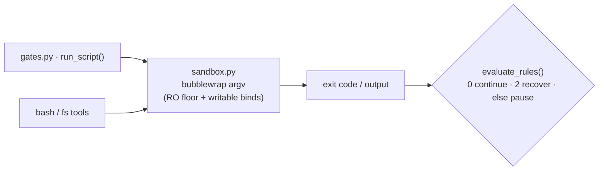

### Zoom 4 — worktree & git

All git mechanics sit behind `worktree.py`. Worktrees are cut under the state directory (`worktrees/<id>/`), and a quest's artifacts live in the quest home (`quests/<id>/artifacts/`, which the worktree reaches as `.imp/quests/<id>/artifacts/`); the engine journals them in-process to a per-quest `refs/imp/artifacts/<id>` ref at each step-completion boundary (agents only write the files). The final merge is lock-protected; at completion the quest is archived — `events.jsonl` is content-addressed into a local blob store with a per-quest record + SQLite index under the state directory's `archive/` — so each quest's events and artifacts survive even after the worktree is pruned (the `refs/imp/artifacts/<id>` ref persists the artifacts; the archive persists the events). A no-merge completion (e.g. the `minimal` workflow) reaches the terminal status `completed` and is archived the same way — searchable, with its home cleaned up — rather than merged into a base.

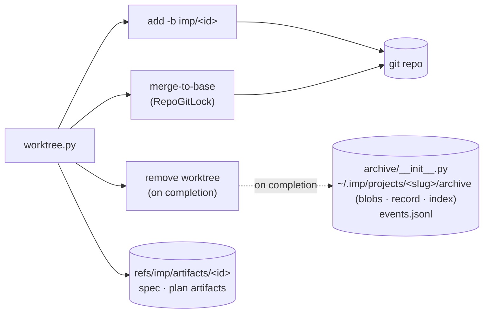

### Zoom 5 — rendering (live & `imp log`)

One event→tree fold feeds both the live view and `imp log`, so they can't diverge.

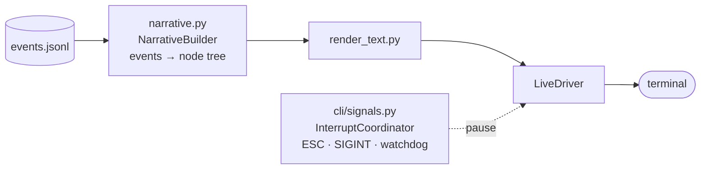

### Component reference

| Layer | Module(s) | Role |
|---|---|---|
| Entry / drivers | `cli/main.py`, `cli/live_driver.py` | Command dispatch; live / headless rendering + signal wiring around `run_change`. |
| CLI reads | `cli/store.py`, `cli/store_proxy.py` | The read seam every CLI command goes through: the `Store` protocol + `LocalStore`'s on-disk reads and row primitives. `make_store()` returns a `ProxyStore` under `IMP_SESSION_SOCKET`, so a sandboxed agent's reads are served by the unsandboxed session daemon instead of the masked state directory. Under the socket, `make_store()` and the mutation relays (`new`, `edit`, `abandon`, `resume`) refuse a cwd whose project differs from `IMP_PROJECT_ROOT`'s. |
| Executor | `engine/executor.py` | Step loop: load → resolve providers → dispatch → route. Returns `COMPLETED \| PAUSED \| ERRORED`. |
| Quest / state | `engine/quest.py`, `engine/state.py` | Per-run identity + worktree; execution cursor, vars, resolved tiers (atomic `save()`); append-only `EventLog`. |
| Workflow load | `engine/loader.py`, `engine/types.py` | Parse `workflow.yaml` + `agents/*.md` into a frozen `Workflow` (phases → steps, agents, vars, rules). |
| Step dispatch | `engine/gates.py`, `engine/expr.py` | `run_script()` (sandboxed commands) + `evaluate_rules()` (Continue / Retry / Pause / Goto + var mutations). |
| Sandbox | `engine/sandbox.py` | Bubblewrap policy baked once; `IMP_*` env injected per spawn. |
| Providers | `providers/*.py`, `providers/resolve.py` | `resolve_run()` maps tiers→(provider, model) once per run; each provider implements the `AgentRunner` protocol. |
| Agent drive / tools | `engine/agent_run.py`, `agents/runner.py`, `agents/tools/*` | Build `AgentInvocation`, consume the event stream, dispatch per-agent allowlisted tools (incl. synthesized `complete_step`, `wait_for_user`). On the Claude runner a `complete_step` batched after another tool in one API message is rejected rather than terminal; the model calls it again after reading the results. |
| Subagents | `agents/subagents.py`, `agents/dispatch.py` | `dispatch_task()` spawns child invocations with depth + parent-event threading. |
| Git | `engine/worktree.py`, `engine/archive/` | Worktree create/remove, lock-protected merge-to-base, engine-journaled per-quest `refs/imp/artifacts/<id>` artifact ref; at completion the quest is archived (content-addressed `events.jsonl` blob + per-quest record + SQLite index under the state directory's `archive/`). |
| Workflow assets | `assets/__init__.py` | Bundled workflows ship with the install; `resolve_workflow_dir` lets a committed `imp/workflows/<name>` override a bundled one. Workflow-agnostic front-door partials ship bundled under `assets/partials/` and are overlaid (local-first) into each quest's `workflow/partials/` at snapshot time, like skills. |
| Rendering | `cli/narrative.py`, `cli/render_text.py` | One event→tree fold shared by live view and `imp log`. |
| Control plane | `cli/signals.py`, `engine/recovery.py`, `providers/errors.py` | Interrupt/pause + watchdog; typed error categories incl. a first-class *terminated*; gate-safe rewind and continue-nudge transcript replay for `imp resume`. |
| Live drivers | `engine/drivers.py` | Per-agent live-driver capability (`drivers:` frontmatter, e.g. `impty`): stdio MCP servers granted to an agent, hosted in imp's own process; the programs they spawn on a pty join the run's sandbox namespace, exactly as `bash` commands do. |

**Invariants:** the event log is the single source of truth (state is a rebuildable cursor); the same `NarrativeBuilder` path renders both live and `imp log`.

---

## Default workflow

Defined in `src/imp/assets/workflows/default/workflow.yaml` (workflow name: **default**; bundled with the install — a committed `imp/workflows/default` overrides it, see the [component reference](#component-reference)). Six phases. `threshold` is the front door — one conversation that answers questions, scouts existing work, or scopes a build. The spec's `## Plan outline` seeds a plan count, and `plan` → `implement` then runs once per outline plan, carrying **no** code review and **no** deferred sweep in the per-plan loop. After the last plan of a multi-plan quest, `converge` runs **once**: the coverage backstop, the single quest-wide code review, the once-per-quest deferred sweep when there is anything to drain, and a slow test gate on the quest's own base. `integrate` then holds the merge lane while it rebases, re-verifies, reviews the integration, and ends at the human gate. An **express** quest (chosen at threshold) skips spec finalization, spec review and the `plan-reviewer` gate — `spec-written` only checks the drafted spec is on disk and announces it; everything from `implement` onward is identical.

Workflow-scoped memory is keyed by the workflow directory name (`imp/memory/<workflow>/`), so a downstream repo carrying `imp/memory/imp/*.md` renames that directory to `imp/memory/default/` after the `imp` → `default` rename.

### Overview

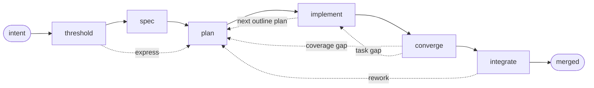

Step kinds across all phases:

- **agent** (boxes) — an LLM agent (`agents/<name>.md`); routes on its validated structured output.
- **script** (`{{ }}` hexagons) — a shell command (`scripts/*.sh`); routes on its own per-step exit-code rules: `0` is the pass path, a step may name further codes (`integrate-rebase` `2` → `summarizer`, `check-cleared` `3` → back to `integration-verify`), and an exit no rule matches falls to that step's `else` — a **pause to human** for the deterministic scripts, a rework route for the test gates.
- **branch** (`{ }` diamonds) — a var router, no agent or script: `check-next-plan` and `wait-for-head` (which also blocks to acquire the merge lane).
- **merge** — engine-native, lock-protected merge to base.

Routing verbs: `continue`, `goto <step>`, `resume <step>` (re-enter with feedback), `pause` (human).

### Phase threshold

One interactive high-tier conversation that answers questions, scouts existing work, or
scopes a build. On go-live it forks the worktree and writes a draft spec; its ceremony
sets `fast_path`. `scope-code-check` then guards the hand-off — the threshold agent must
not have committed code to the branch while scoping; if it did, it is resumed to undo it.
On the express path `spec-written` then checks the draft spec is on disk and shows a
one-line marker; if it is missing, threshold is resumed to write it.

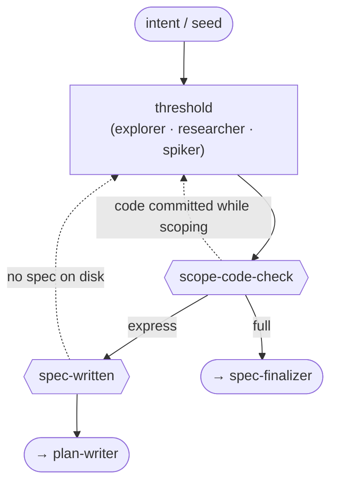

### Phase spec

`spec-finalizer` adopts the threshold draft and commits the final spec, including its
`## Plan outline`. The gate counts the outline's numbered plans to seed `plan_total`, so
the planning label carries the real denominator. A Critical or Major finding bounces the
spec back to the writer and is re-reviewed; a clean review sends it forward to
`plan-writer`, carrying the reviewer's Minor findings with it as advisory context rather
than buying another lap.

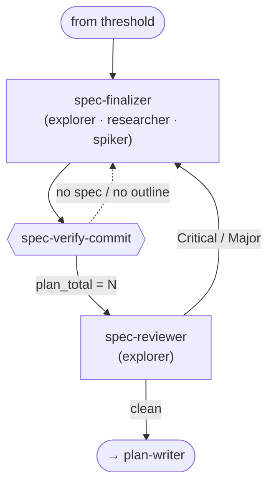

### Phase plan

`plan-writer` is the plan-phase entry: the spec phase, the next-plan loop, a gap-check
corrective, and a finalize rework all `goto` it directly. It writes this outline plan's
slice, the gate verifies the artifact, `plan-reviewer` routes the same way — a blocking
finding back to the writer, a clean review forward with its Minor findings carried to
`task-lead` in `plan_review_notes` — and `plan-finalized` counts `## Task N` headers to
seed `task_total`.

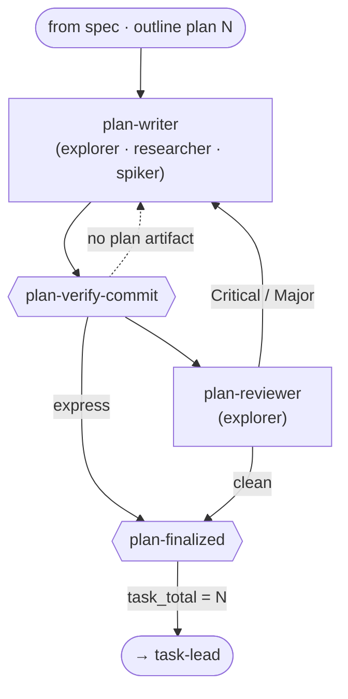

### Phase implement

Three steps. `task-lead` drives one task at a time, dispatching `coder` and
`code-reviewer` subagents and committing one clean unit per task; `verify` runs the
project's fast test gate (a gate **timeout** pauses to a human rather than looping);
`check-next-plan` is a pure router with no execution. There is no code review, no
autosquash, and no deferred sweep in this phase — all of that moved to `converge`.

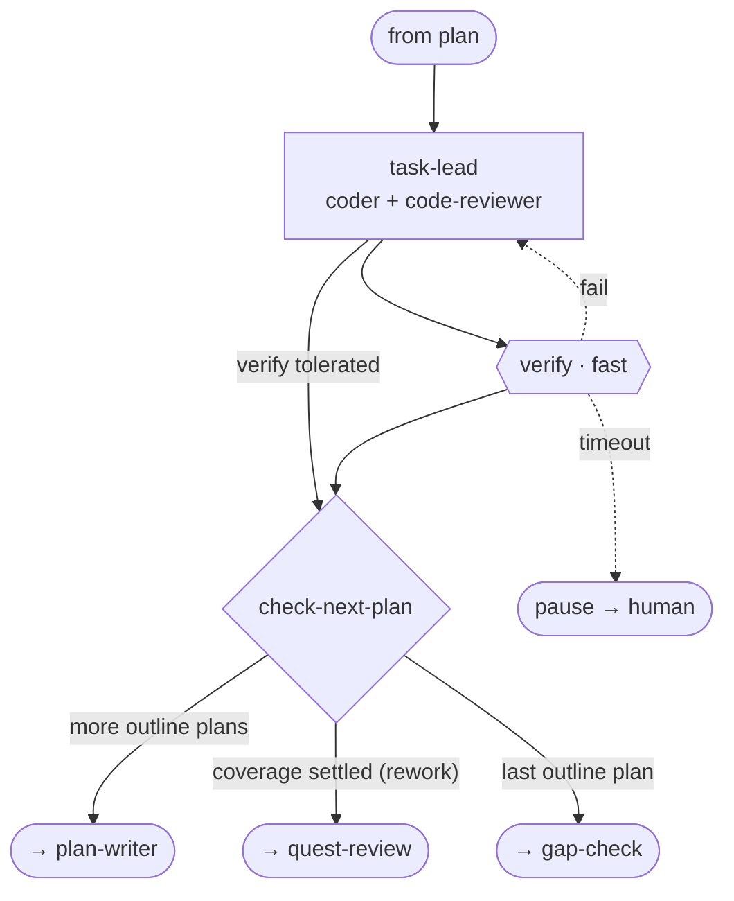

### Phase converge

Runs once per quest, quest-local and off-lock. `gap-check` is the sole coverage backstop;
a gap authors a corrective plan (the **supercycle**) beyond the outline, and a clean pass
latches `coverage_settled` so a later rework re-enters at `quest-review` and never
re-runs the backstop. `quest-review` is the single quest-wide code review over
`cur_base_head..HEAD`. `deferred-check` then guards the sweep — a script step, because a
rule condition cannot read the filesystem: with nothing to drain it skips straight to
`wait-for-head`, and it fails closed, so any doubt dispatches. `deferred-sweep`
therefore runs only when the quest's deferred list holds an open item, drains the whole
list once when it does, and then hands the quest to the merge queue.

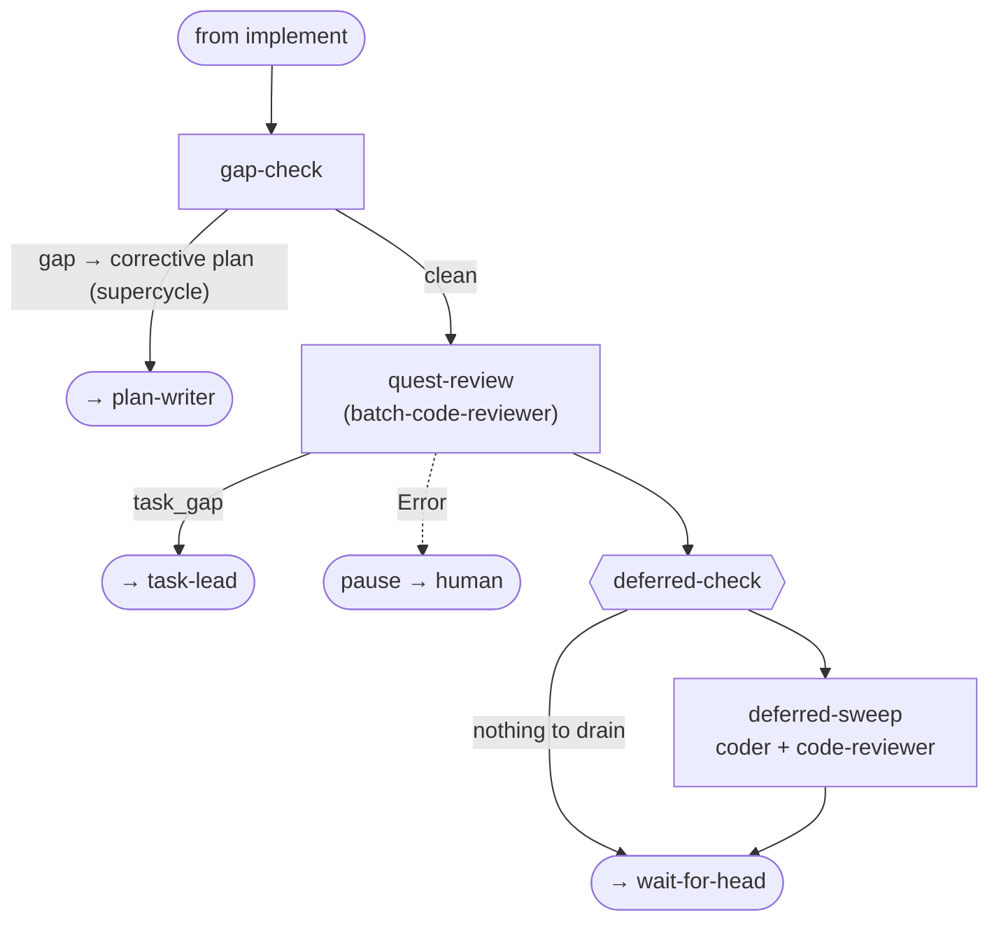

### Phase integrate

The FIFO merge queue. `wait-for-head` acquires the merge lane and normally holds it for
the rest of the phase. A quest holding the merge lane takes the next free test-lane slot
ahead of other waiting verify gates. `integrate-rebase` routes on four outcomes: base
unmoved with the tree already cleared skips straight to `summarizer` with no re-review; a
clean rebase or an uncleared tree goes to `validate-memory`; a conflict hands off to
`reconciler`; a bad base ref or dirty tree pauses. `validate-memory` re-runs imp's own
load-time memory validation over the merged tree. `integration-verify` routes to
`integration-reviewer` on **both** pass and failure — a failure asks the reviewer to
adjudicate fix-vs-tolerate rather than pausing. `check-cleared` then re-asks the shared
clearance predicate at the merge door: a tree the slow gate never passed — an
environmental failure the reviewer repaired, say — routes back to `integration-verify`
instead of reaching the human. `finalize` is the human gate; a rework releases the merge
lane on its way back to `plan-writer`.

A failure pause inside the phase evicts the merge lane rather than leaving a stalled
quest holding it — another quest's merge must never wait on a paused one — and rewinds
the resume cursor to `wait-for-head`. The eviction first records a restore point: the
step the cursor was on, the base branch tip, and the quest worktree HEAD. When the lane
is re-acquired and both SHAs are unchanged, the phase resumes at that step, so
`summarizer` and `finalize` never re-run; if either moved, the restore point is dropped
and the phase continues into `integrate-rebase` for a rebase and a re-verify. A clean
interrupt retains the lane instead of evicting it. A run that died holding the lane —
SIGKILL, reboot — records no restore point, because a fingerprint taken at the next
process entry describes the world at resume rather than at the crash; that path
replays the phase from `wait-for-head`.

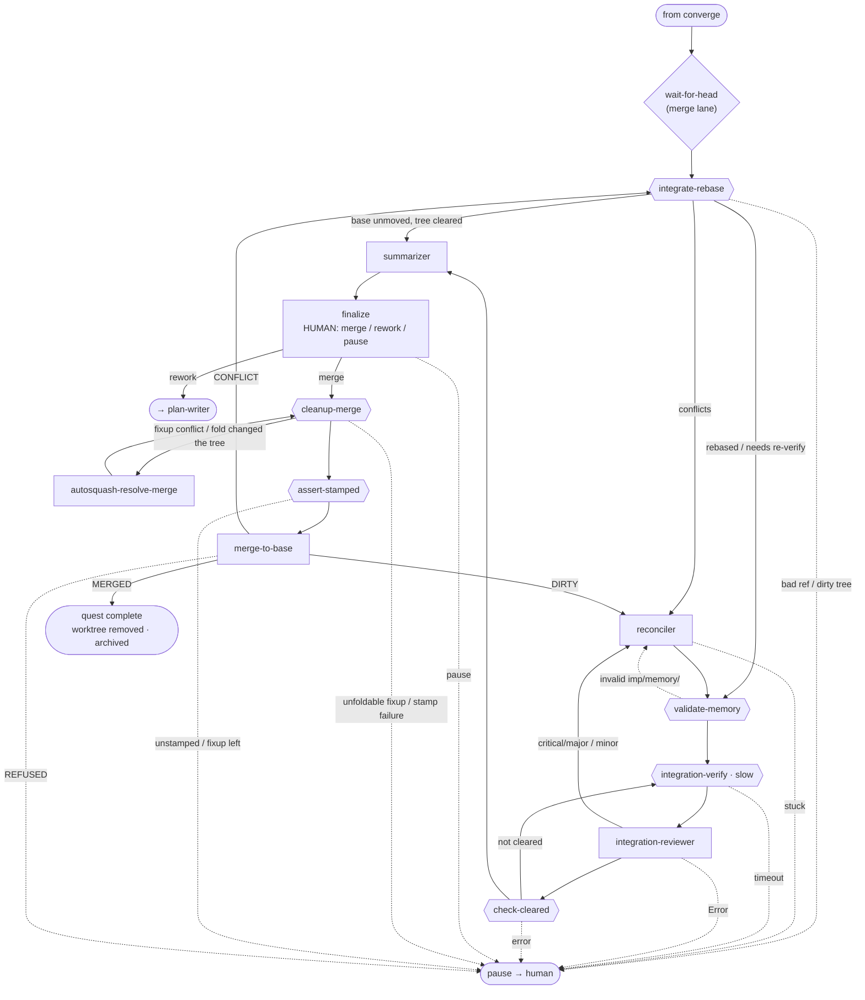

### Agent reference

Step agents — the step name is spelled out because three of them differ from the file
name:

| Agent file | Step | Tier | Role |
|---|---|---|---|
| `threshold` | `threshold` | high | Front-door conversation: answer, scout, or scope; set the ceremony and go live. |
| `spec-finalizer` | `spec-finalizer` | high | Adopt the threshold draft, commit the final spec with its plan outline, service the review loop. |
| `spec-reviewer` | `spec-reviewer` | high | Review the spec against captured intent; any Critical/Major sends it back. |
| `plan-writer` | `plan-writer` | high | Write this outline plan's slice — the HOW — and commit it. |
| `plan-reviewer` | `plan-reviewer` | high | Review the newest plan's prescribed code like a diff; any Critical/Major sends it back. |
| `task-lead` | `task-lead` | high | Implement controller: pick a task, dispatch coder + reviewer, adjudicate, commit one unit, record progress. |
| `gap-check` | `gap-check` | high | Once-per-quest coverage backstop: do the implemented plans cover the spec, or is a corrective plan needed. |
| `batch-code-reviewer` | `quest-review` | high | The single quest-wide code review of the whole diff vs the spec; routes approve / task_gap. |
| `deferred-sweep` | `deferred-sweep` | high | Drain the quest's deferred followups once; may dispatch coder + code-reviewer for fixes. |
| `reconciler` | `reconciler` | high | Reconcile the branch against a moved base: resolve conflicts, fix what the base broke. |
| `integration-review` | `integration-reviewer` | high | At-head semantic integration review; classifies findings and routes back to the reconciler. |
| `summarizer` | `summarizer` | medium | Write the quest's intent-level summary artifact. |
| `finalize` | `finalize` | high | The human gate: merge / rework / pause. |
| `autosquash-resolve` | `autosquash-resolve-merge` | high | Make the fixup fold reproduce the pre-squash tree: resolve a conflict, or repair a fold that changed content. |

Tiers come from `workflow.yaml`, which declares every step `high` except `summarizer`
(medium).

These are dispatched via `subagents:` frontmatter and are **never** a workflow step:

| Subagent | Dispatched by |
|---|---|
| `coder` | `task-lead`, `deferred-sweep` |
| `code-reviewer` | `task-lead`, `deferred-sweep` |
| `explorer` | `threshold`, `spec-finalizer`, `spec-reviewer`, `plan-writer`, `plan-reviewer`, `task-lead`, `finalize` |
| `researcher` | `threshold`, `spec-finalizer`, `plan-writer`, `task-lead`, `finalize` |
| `spiker` | `threshold`, `spec-finalizer`, `plan-writer`, `task-lead`, `finalize` |

### Data files

These live in the quest home under the state directory (see *Where state lives*); an agent in a worktree reaches them through `.imp/quests/<id>/`. `artifacts/` means committed: everything under it is journaled by the engine to the quest's `refs/imp/artifacts/<id>` ref (see *Zoom 4 — worktree & git*), which is what keeps it readable after the worktree is pruned. `imp show <id> <name>` prints any file under `artifacts/`, from the live quest home or from that ref. Throwaway spiker evidence is deliberately outside that boundary, in the sibling `spike/`, which the engine never journals — it dies with the quest home.

The columns list the **principal** writers and readers, not an exhaustive census —
`deferred.md` in particular is appended to by many agents (any agent may file a
`— needs-decision:` item) and read by more still, and enumerating that is drift bait.

| File (relative to the quest home) | Written by | Read by |
|---|---|---|
| `artifacts/spec/{id}.md` | threshold (draft) → spec-finalizer (final) | all phases, `imp show` |
| `artifacts/plans/{id}-plan-N.md` | plan-writer | task-lead, plan-reviewer, gap-check, batch-code-reviewer, deferred-sweep, summarizer, `imp show` |
| `artifacts/summary/{id}.md` | summarizer | finalize, the `merge-to-base` step (merge commit body), `imp show` |
| `artifacts/verify/{id}.md` | the `verify` / `integration-verify` gates | `imp show` |
| `progress.md` | task-lead, deferred-sweep | all implement/converge steps (tasks, commit subjects) |
| `deferred.md` | task-lead, deferred-sweep | gap-check, deferred-sweep, finalize |

---

## Minimal workflow

`src/imp/assets/workflows/minimal/` is a small, no-merge workflow: it scopes a small change, then
builds it in a **forked worktree** on `imp/<id>` and completes with **no merge**, leaving
the commits on that branch for the user to integrate manually. The change runs through a
short sequence of steps:

- **front-door** — the shared front-door conversation (the same
  `partials/front-door.md` the default workflow uses) scopes the change and, on go-live,
  calls `create_and_enter_worktree` — so the quest **is** materialized — and writes the
  final spec directly. There is no separate finalizer and no plan.
- **implement** — the `implementer` agent reads the spec, makes the change, and commits
  on the quest branch `imp/<id>` in the worktree (no plan).
- **review** — the **read-only** `reviewer` agent diffs exactly the commits imp added
  (`git diff cur_base_head HEAD`, the quest's fork point) against the spec; a `rework`
  verdict resumes `implement` with feedback, `approve` flows into `finalize`.
- **finalize** — an interactive, high-tier human gate. It composes its own intent-level
  summary from the spec and the quest diff (there is no summarizer step or artifact),
  opens with it (confirming the commits sit on `imp/<id>` for manual integration), and
  lets the user request changes — which the gate applies and commits itself on the
  branch, with no re-review by the reviewer. On approval it completes the run; an
  autonomous run auto-completes without soliciting.

The run has no test/verify gate and no summarizer step; it ends on the interactive
`finalize` human gate before completing. It
completes with the terminal status **`completed`** and is archived like any completed
quest — searchable, home cleaned up — with its worktree removed and the `imp/<id>`
branch kept, holding the commits (it has no `merge_commit`).

---

*Part of imp's self-knowledge corpus. Runtime entry point: load the `imp-knowledge` skill (`load_skill(name="imp-knowledge")`), the thin index that maps into this corpus.*
